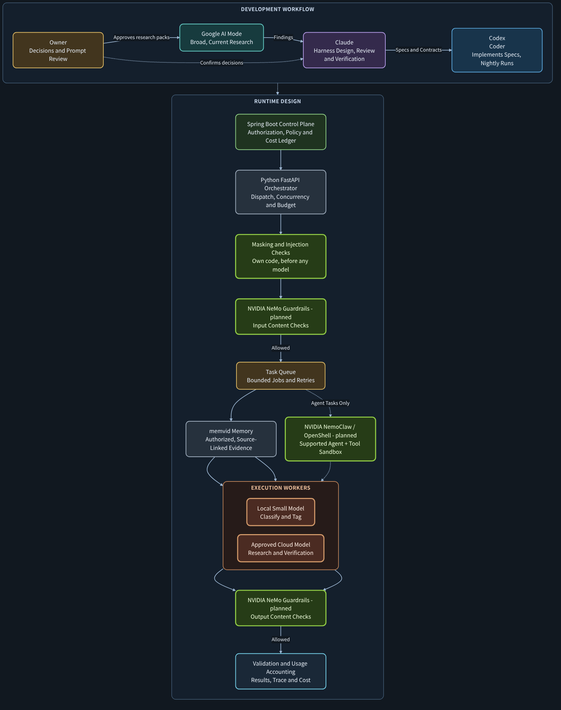
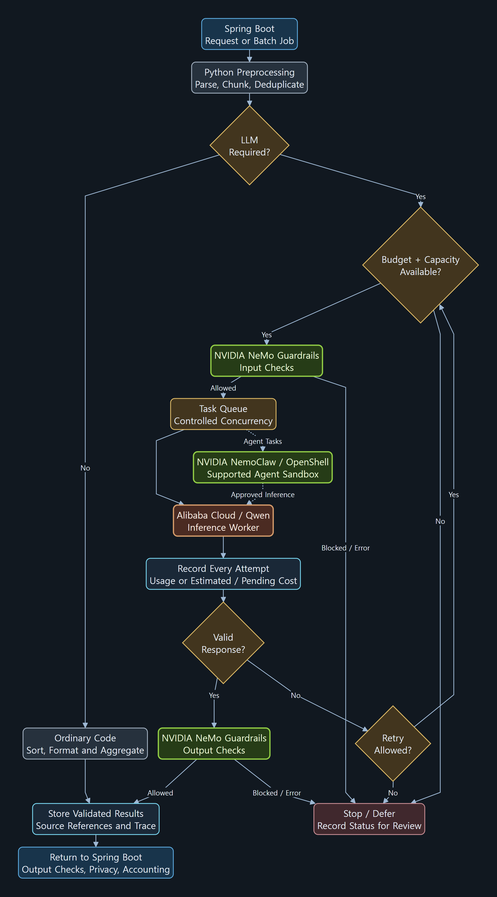
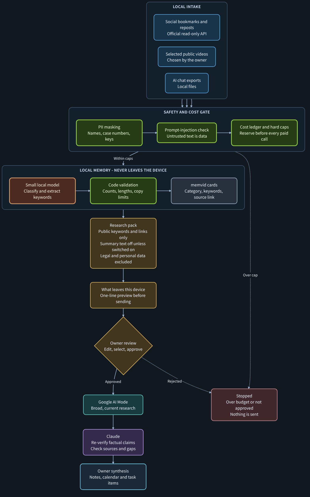

# AI Multi-Agent Orchestration

[](assets/diagrams/orchestration-architecture-dark.svg)

[](assets/diagrams/orchestration-runtime-dark.svg)

*Proposed orchestration architecture and runtime flow.*

A portfolio hub for designing, building and verifying **multi-agent system harnesses**: role separation between models, safety and cost gates, privacy masking and a replaceable memory layer. The designs below are in active development. Status labels in each table state what is implemented, what is a design, and what is still planned.

## Who am I

```text
Medical background
+ Legal dispute structuring experience
+ Ontology-driven thinking
+ AI-native PM / backend orchestration
= Legal/Medical AI Technical PM
```

## Market Focus

I am preparing for this market by focusing on the intersection of:

```diff
Legal / Medical domain knowledge
+ ontology-driven problem structuring
+ backend AI server architecture
+ multi-agent orchestration
+ safe and observable AI workflows
```

At the current stage, I am especially focused on the Legal/Medical part because these domains have complex documents, high-risk reasoning, evidence structure, procedural workflows, and strong demand for safer AI systems.

My backend study is the execution layer for that direction: Java 21, Spring Boot REST APIs, JSON contracts, Virtual Threads, monitoring, observability, and the FastAPI, memvid and guardrail integration described below.

## Research Harness Design

One of the harnesses under development turns scattered reading (social bookmarks, selected videos, AI chat exports) into reviewed research, while keeping private data on the device and spending under a hard cap.

[](assets/diagrams/research-harness-flow-dark.svg)

*Research harness flow. Intake is local; masking, injection checks and cost caps run before any model call; memory stays on the device; the owner reviews what leaves the device.*

| Control | How the design handles it |
| --- | --- |
| Roles | A small local model filters and tags. Google AI Mode performs broad, current research. Claude re-verifies factual claims and checks sources. The owner reviews and approves every outbound pack. |
| Security | Intake uses official read-only access. Fetched text is treated as untrusted data and checked for prompt injection. Code, not the model, validates every model output. |
| Privacy | Names, case numbers and keys are masked before any model sees the text. Legal and personal material is never part of an outbound pack. |
| Cost | A cost ledger reserves budget before each paid call and enforces hard caps. Over-cap work stops instead of retrying. |
| Memory | Compact cards (category, keywords, source link) live in a local memvid memory layer behind a single function boundary, so it can be replaced without touching callers. |
| Data minimization | Outbound packs contain public keywords and links by default. Summary text is off unless explicitly switched on, and a one-line preview shows what leaves the device. |

**Status:** design and development in progress. The test suite passes on the author's Windows PC (465 tests, 2026-10-30); runs against real accounts and services are not yet verified. Details: [nightcoder](https://github.com/ai-agent-orchestrator/nightcoder).

## Implementation and Extension Plan

The foundation below is implemented at demo scope. Everything under "Extension" is in active design or development, and each row links to its repository.

| Stage | Track | Scope | Status |
| --- | --- | --- | --- |
| Foundation | API and persistence | Java 21 · Spring Boot · REST · JSON contracts · JPA / SQL | Implemented (demo scope), [legal-ai-intake-system](https://github.com/ai-agent-orchestrator/legal-ai-intake-system) |
| Foundation | Concurrency | Virtual Threads · asynchronous HTTP calls · SSE | Implemented (demo scope) |
| Foundation | Client and operations | React · Vite · Actuator · Prometheus | Implemented (demo scope) |
| Foundation | Application controls | Authentication · privacy output guard · risk and audit history · cost controls | Implemented (demo scope) |
| Extension | Async execution | Spring Boot virtual threads with bulkhead and circuit breaker; FastAPI asyncio with cancel-safe billing; measured before and after | Design and phase specs, measurements pending, [spring-fastapi-async-refactor](https://github.com/ai-agent-orchestrator/spring-fastapi-async-refactor) |
| Extension | Memory layer | Spring authorizes, FastAPI executes, memvid remembers: case-level memory files, authorization before file access, source-linked evidence | Architecture proposal, integration and production security not yet validated, [spring-memvid-ai-backend](https://github.com/ai-agent-orchestrator/spring-memvid-ai-backend) |
| Extension | Research harness | Local intake, masking, cost ledger, local cards, reviewed research packs (see above) | In development, [nightcoder](https://github.com/ai-agent-orchestrator/nightcoder) |
| Extension | Overnight relay harness | Spec inbox, lanes, scheduler, gates, subscription-only coding agents, hard daily caps | In development, [nightcoder](https://github.com/ai-agent-orchestrator/nightcoder) |
| Extension | Legal intake product | Spring Boot + FastAPI hybrid with memvid memory; commercialization planned | In development, [legal-ai-intake-system](https://github.com/ai-agent-orchestrator/legal-ai-intake-system) |
| Planned | Shared harness core | Extract the common layer (role contracts, safety and cost gates, masking, memory boundary) so new domain modules attach to it | Planned |
| Planned | Content guardrails | NVIDIA NeMo Guardrails | Planned deployment |
| Planned | Agent execution security | NVIDIA NemoClaw / OpenShell for supported agent runtimes | Planned |
| Planned | Inference workers | Meta Llama | Model version and hosting to be selected and validated |

The planned inference-worker model is [Meta Llama](https://github.com/meta-llama/llama-models). The exact model version and hosting option remain to be selected and validated. Input/output guardrails, bounded retries, privacy checks, and usage accounting remain part of the proposed runtime regardless of model choice.

## Direction

Going forward, my work concentrates on **multi-agent system harness engineering**: a reusable core for role separation, safety and cost gates, privacy masking and memory, with domain modules (research, overnight development, legal intake) attached to it. Each design is built in small steps, written down with its limits, and checked by tests and measurements before it is described as working.

## More in this repository

| Document | What it covers |
| --- | --- |
| [AI-assisted development playbook](AI_ASSISTED_DEVELOPMENT_PLAYBOOK.md) | Lessons from building with AI assistance: AI output becomes useful once it is tested against real workflow, feedback and documentation |
| [AI ecosystem stack watch](AI_ECOSYSTEM_STACK_WATCH.md) | The multi-agent development and control stack in practice |
| [Portfolio projects](portfolio) | Selected projects connecting backend engineering, AI-assisted development and architecture learning |
