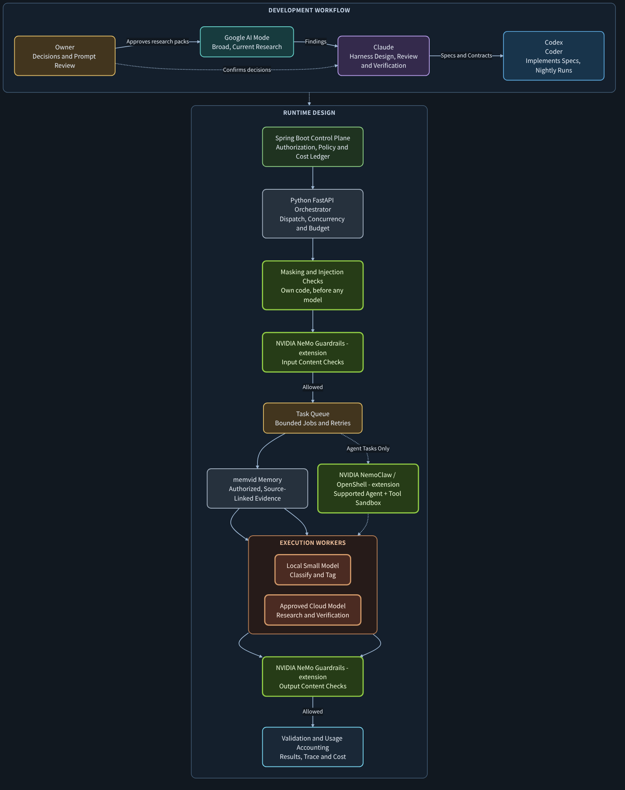
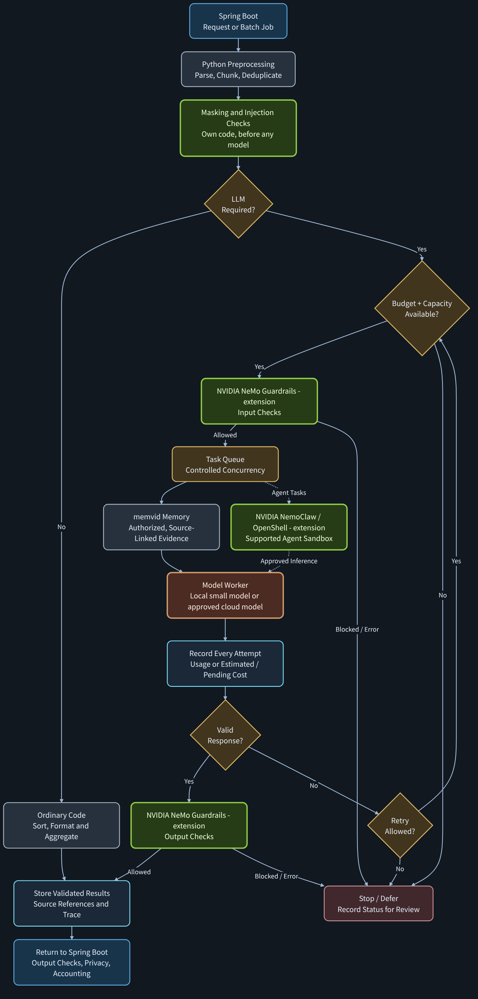
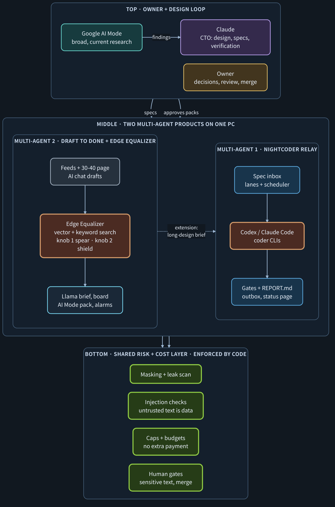
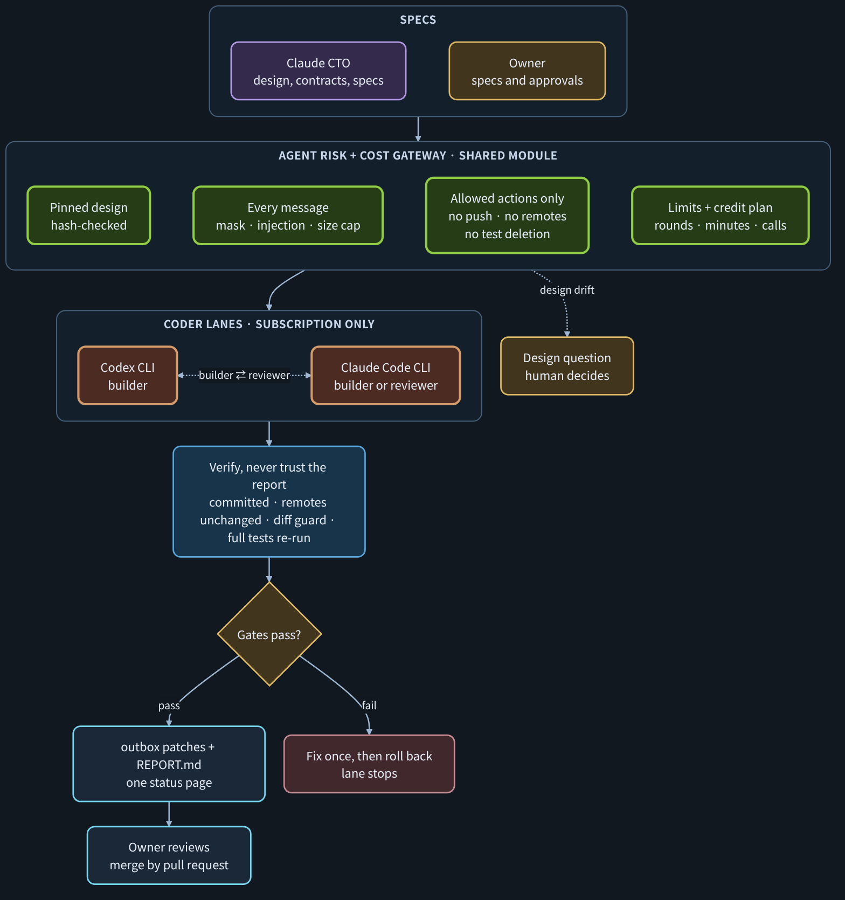
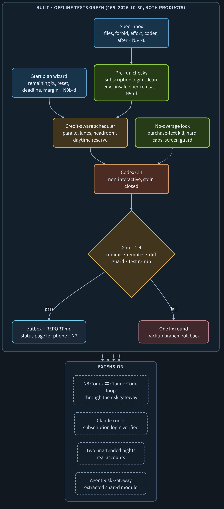
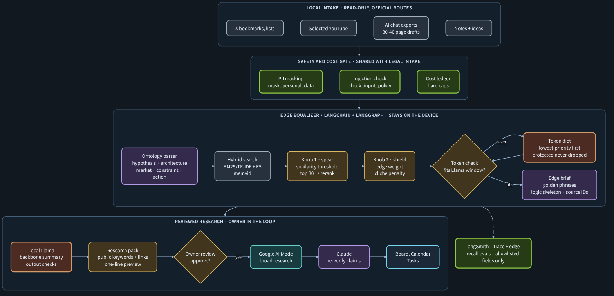
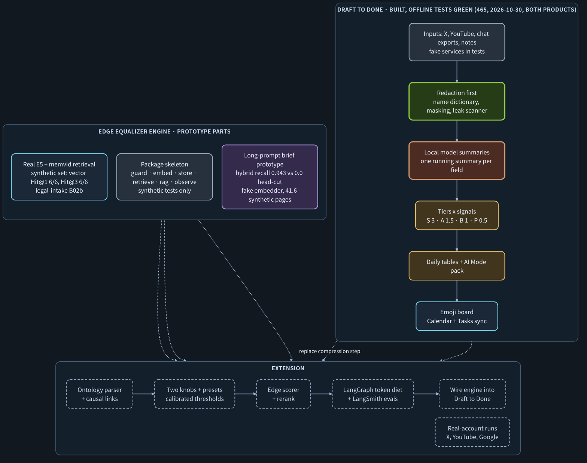
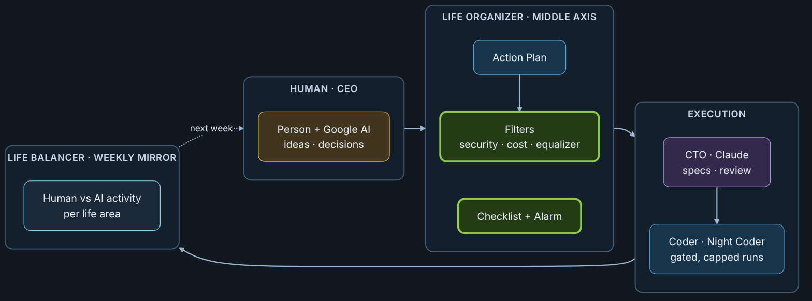

# AI Multi-Agent Orchestration

[](assets/diagrams/orchestration-architecture-dark.svg)

[](assets/diagrams/orchestration-runtime-dark.svg)

*Proposed orchestration architecture and runtime flow.*

A portfolio hub for designing, building and verifying **multi-agent system harnesses**: role separation between models, safety and cost gates, privacy masking and a replaceable memory layer. The designs below are in active development. Status labels in each table state what is implemented, what is a design, and what is an extension.

## Who am I

```text
Medical background
+ Legal dispute structuring experience
+ Ontology-driven thinking
+ AI-native PM / backend orchestration
= Legal/Medical AI Technical PM
```

## How AI changed the way I work (2026)

*Three multi-agent systems that semi-automate my life, with clear priorities and balance.*

| When | With | What changed |
| --- | --- | --- |
| ~6 months ago | Google AI (Gemini, AI Mode) | I started running every important decision (work, health, money, legal) through structured AI research. Judgment got faster and better grounded. |
| ~3 months ago | Codex | Coding stopped being the bottleneck. I caught up quickly and moved from using AI to designing and building AI backends myself (Spring Boot, FastAPI, LangGraph). |
| Now | Claude as CTO, Codex as coder | I build my own multi-agent tools and run them daily: NightCoder codes overnight, Draft to Done turns research into action, Life Organizer keeps the week balanced. The same engine powers what I am taking to market: Legal Intake, then Medical. |

The goal is simple: spend less time on mechanical work and more on research, strategic planning, decisions and action, across a wide and deep range of areas. I run these systems on myself first and measure what they change before offering them to anyone else.

## Market Focus

I am preparing for this market by focusing on the intersection of:

```diff
Legal / Medical domain knowledge
+ ontology-driven problem structuring
+ backend AI server architecture
+ multi-agent orchestration
+ safe and observable AI workflows
```

At the current stage, I am especially focused on the Legal/Medical part because these domains have complex documents, high-risk reasoning, evidence structure, procedural workflows, and strong demand for safer AI systems.

My backend study is the execution layer for that direction: Java 21, Spring Boot REST APIs, JSON contracts, Virtual Threads, monitoring, observability, and the FastAPI, memvid and guardrail integration described below.

## Three Multi-Agent Systems

Two products run on one PC behind one shared risk and cost layer. **Multi-agent 1 builds code overnight; multi-agent 2 turns reading and long AI-chat drafts into reviewed research without flattening the owner's original ideas.** Multi-agent 3 is the operating layer above both: it keeps the person in charge of the three roles (CEO · CTO · Coder) and of their week.

[](assets/diagrams/multi-agents-overview-dark.svg)

*Layers stack top to bottom. Results flow back up as pull requests (Relay) and reviewed research packs (Draft to Done); those return arrows are left out to keep the layers readable.*

| | Multi-agent 1 · NightCoder Relay | Multi-agent 2 · Draft to Done + Edge Equalizer |
| --- | --- | --- |
| Job | queue specs, run subscription coder CLIs overnight, verify the work | digest feeds and 30–40 page AI-chat drafts into a brief, a research pack and a daily board |
| Agents | Claude (CTO, specs) · Codex CLI · Claude Code CLI | local Llama · Google AI Mode · Claude (verification) |
| Core idea | never trust the coder's report: re-run the tests, guard the diff, never push | two knobs instead of dozens of settings: **spear** (similarity threshold) finds, **shield** (edge preservation weight) keeps the original ideas |
| Human step | review and merge by pull request | approve what leaves the device, ask the questions in AI Mode |
| Status | built, offline tests green | pipeline built and offline-tested; Edge Equalizer engine at prototype parts |

### Multi-agent 1 · NightCoder Relay

Claude or the owner writes specs. The relay hands them to a coder CLI one by one through the risk and cost gateway, re-checks everything the coder claims, and returns patches with a report.

**Concept design**

[](assets/diagrams/agent1-relay-concept-dark.svg)

**Current prototype**

[](assets/diagrams/agent1-relay-prototype-dark.svg)

| Built (offline tests) | Extension |
| --- | --- |
| Start-plan wizard and credit-aware scheduler (N9b–d) | N8 Codex ⇄ Claude Code builder-reviewer loop through the gateway |
| Spec headers, parallel lanes, `after:` dependencies (N5–N6) | Claude coder with a verified subscription login (runs use `coder: codex` today) |
| Subscription-only coders, clean environment, unsafe-spec refusal, hard caps, screen guard (N9a–f) | Two unattended nights on real accounts |
| Gates 1–4, one fix round, rollback, outbox, status page (N1–N7) | Agent Risk Gateway extracted as a shared module |

### Multi-agent 2 · Draft to Done + Edge Equalizer

Long brainstorming drafts carry the owner's sharpest ideas, and ordinary summarization flattens them into clichés. The Edge Equalizer is a LangChain + LangGraph retrieval engine that sits between the safety gate and the local Llama: it parses the draft into an ontology, searches with keywords and vectors, and builds a brief that fits the model's window without dropping protected ideas.

**Concept design**

[](assets/diagrams/agent2-research-concept-dark.svg)

| Knob | Low | High |
| --- | --- | --- |
| 1 · Spear: similarity threshold | broad exploration, distant connections | precise, only closely matching passages |
| 2 · Shield: edge preservation weight | readable summary in ontology order | extract-only, golden phrases first, clichés cut |

Presets combine the two: **research and idea fusion** (spear low, shield high) and **evidence analysis** (spear high, shield high). Thresholds are calibrated per embedding model on a golden set, not fixed numbers. Everything else (token budget, protection rules, score weights) is versioned configuration, not a knob.

**Current prototype**

[](assets/diagrams/agent2-research-prototype-dark.svg)

| Built or measured | Extension |
| --- | --- |
| Draft to Done pipeline: inputs, redaction, local summaries, tiers, tables, AI Mode pack, board, Calendar and Tasks (offline tests) | Ontology parser with causal links |
| Real E5 + memvid retrieval on a synthetic set: vector Hit@1 6/6, Hit@3 6/6 ([legal-intake-fastapi-lab](https://github.com/ai-agent-orchestrator/legal-intake-fastapi-lab), B02b) | Two knobs, presets and calibrated thresholds |
| Engine package skeleton with synthetic tests ([langchain-rag-research-agent](https://github.com/ai-agent-orchestrator/langchain-rag-research-agent), formerly python-memvid-guardrail) | Edge scorer and reranking |
| Long-prompt brief prototype: hybrid recall 0.943 vs 0.0 for head truncation, fake embedder on 41.6 synthetic pages | LangGraph token diet and LangSmith edge-recall evaluation |
| | Engine wired into Draft to Done in place of the compression step; real-account runs |

### Multi-agent 3 · CEO-CTO-Coder (Life Organizer + Life Balancer)

Not more agents, but three clear roles, one controlled axis in the middle, and a weekly look back. The **Life Organizer** turns ideas into small tasks, filters research before it reaches a coder, keeps every agent on a checklist and stops loops, overspend and failures. The **Life Balancer** compares, per life area, what the person did and what AI did; AI work counts only after the person approves it.

**Concept design**

[](assets/diagrams/agent3-ceo-cto-coder-concept-dark.svg)

| Part | Role |
| --- | --- |
| CEO · person + Google AI | think, research, decide; approve anything irreversible |
| Life Organizer | Action Plan (ideas → tasks) · filters (security, cost, equalizer) · Checklist + Alarm |
| CTO · Claude / Coder · Codex via NightCoder Relay | specs and review / gated, capped overnight implementation (multi-agent 1) |
| Life Balancer | weekly mirror of human vs AI activity per life area, against the person's own weights |

**Status:** concept design for personal use. Some guard pieces already exist in multi-agent 1 (masking, hard caps, stop file, test gates); the rest is design. Implementation is kept private..

The earlier research-harness flow ([diagram](assets/diagrams/research-harness-flow-dark.svg)) is the intake and review shell that this design keeps.

**Status:** design and development in progress. Both products pass their test suite on the author's Windows PC (465 tests, 2026-10-30); runs against real accounts and services are not yet verified. Details: [nightcoder](https://github.com/ai-agent-orchestrator/nightcoder).

## Implementation and Extension Plan

The foundation below is implemented at demo scope. Everything under "Extension" is in active design or development, and each row links to its repository.

| Stage | Track | Scope | Status |
| --- | --- | --- | --- |
| Foundation | API and persistence | Java 21 · Spring Boot · REST · JSON contracts · JPA / SQL | Implemented (demo scope), [legal-ai-intake-system](https://github.com/ai-agent-orchestrator/legal-ai-intake-system) |
| Foundation | Concurrency | Virtual Threads · asynchronous HTTP calls · SSE | Implemented (demo scope) |
| Foundation | Client and operations | React · Vite · Actuator · Prometheus | Implemented (demo scope) |
| Foundation | Application controls | Authentication · privacy output guard · risk and audit history · cost controls | Implemented (demo scope) |
| Extension | Async execution | Spring Boot virtual threads with bulkhead and circuit breaker; FastAPI asyncio with cancel-safe billing; measured before and after | Design and phase specs, measurements pending, [spring-fastapi-async-refactor](https://github.com/ai-agent-orchestrator/spring-fastapi-async-refactor) |
| Extension | Memory layer | Spring authorizes, FastAPI executes, memvid remembers: case-level memory files, authorization before file access, source-linked evidence | Architecture proposal, integration and production security not yet validated, [spring-memvid-ai-backend](https://github.com/ai-agent-orchestrator/spring-memvid-ai-backend) |
| Extension | Multi-agent 2 · Draft to Done | Local intake, masking, cost ledger, local cards, reviewed research packs (see above) | In development, [nightcoder](https://github.com/ai-agent-orchestrator/nightcoder) |
| Extension | Multi-agent 2 · Edge Equalizer engine | Ontology parsing, keyword + vector search, two knobs, LangGraph token diet, LangSmith evaluation | Design reviewed, prototype parts, [langchain-rag-research-agent](https://github.com/ai-agent-orchestrator/python-memvid-guardrail) |
| Extension | Multi-agent 1 · NightCoder Relay | Spec inbox, lanes, scheduler, gates, subscription-only coding agents, hard daily caps | In development, [nightcoder](https://github.com/ai-agent-orchestrator/nightcoder) |
| Extension | Legal intake product | Spring Boot + FastAPI hybrid with memvid memory; commercialization as an extension | In development, [legal-ai-intake-system](https://github.com/ai-agent-orchestrator/legal-ai-intake-system) |
| Extension | Multi-agent 3 · CEO-CTO-Coder | Life Organizer (Action Plan, filter chain, Checklist + Alarm, exception routing, weekend→weekday context bridge) and Life Balancer (weekly human vs AI review) | Concept design, [ceo-cto-coder](https://github.com/ai-agent-orchestrator/ceo-cto-coder) |
| Extension | Shared harness core | Extract the common layer (role contracts, safety and cost gates, masking, memory boundary) so new domain modules attach to it | Extension |
| Extension | Content guardrails | NVIDIA NeMo Guardrails | Extension |
| Extension | Agent execution security | NVIDIA NemoClaw / OpenShell for supported agent runtimes | Extension |
| Extension | Inference workers | Meta Llama | Model version and hosting to be selected and validated |

The inference-worker model for this extension is [Meta Llama](https://github.com/meta-llama/llama-models). The exact model version and hosting option remain to be selected and validated. Input/output guardrails, bounded retries, privacy checks, and usage accounting remain part of the proposed runtime regardless of model choice.

## Direction

Going forward, my work concentrates on **multi-agent system harness engineering**: a reusable core for role separation, safety and cost gates, privacy masking and memory, with domain modules (research, overnight development, legal intake) attached to it. Each design is built in small steps, written down with its limits, and checked by tests and measurements before it is described as working.

## More in this repository

| Document | What it covers |
| --- | --- |
| [AI-assisted development playbook](AI_ASSISTED_DEVELOPMENT_PLAYBOOK.md) | Lessons from building with AI assistance: AI output becomes useful once it is tested against real workflow, feedback and documentation |
| [AI ecosystem stack watch](AI_ECOSYSTEM_STACK_WATCH.md) | The multi-agent development and control stack in practice |
| [Portfolio projects](portfolio) | Selected projects connecting backend engineering, AI-assisted development and architecture learning |
