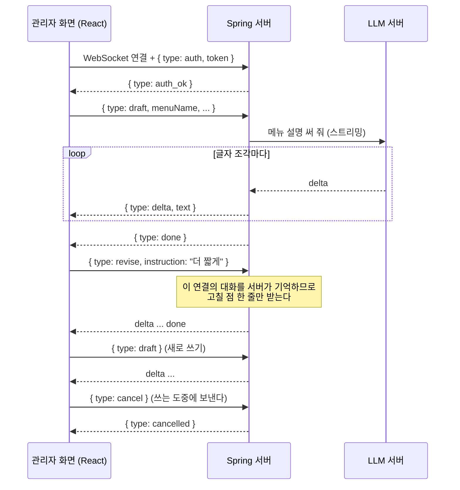
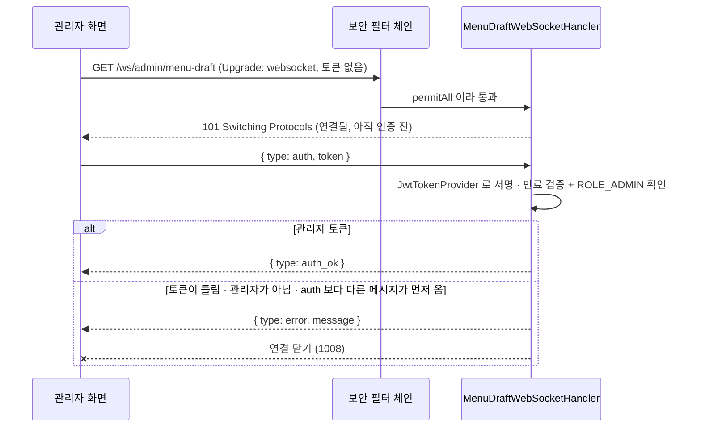
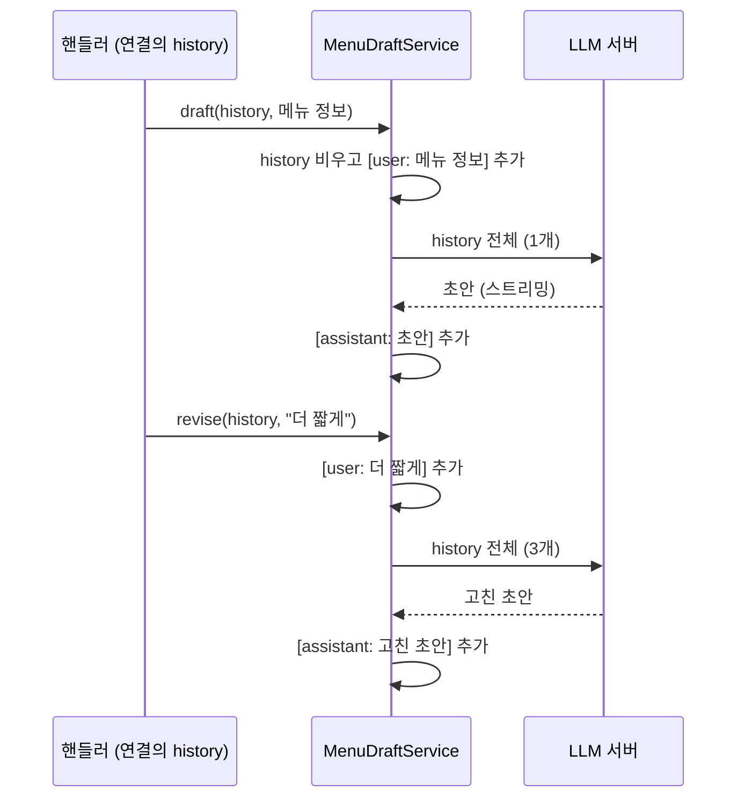
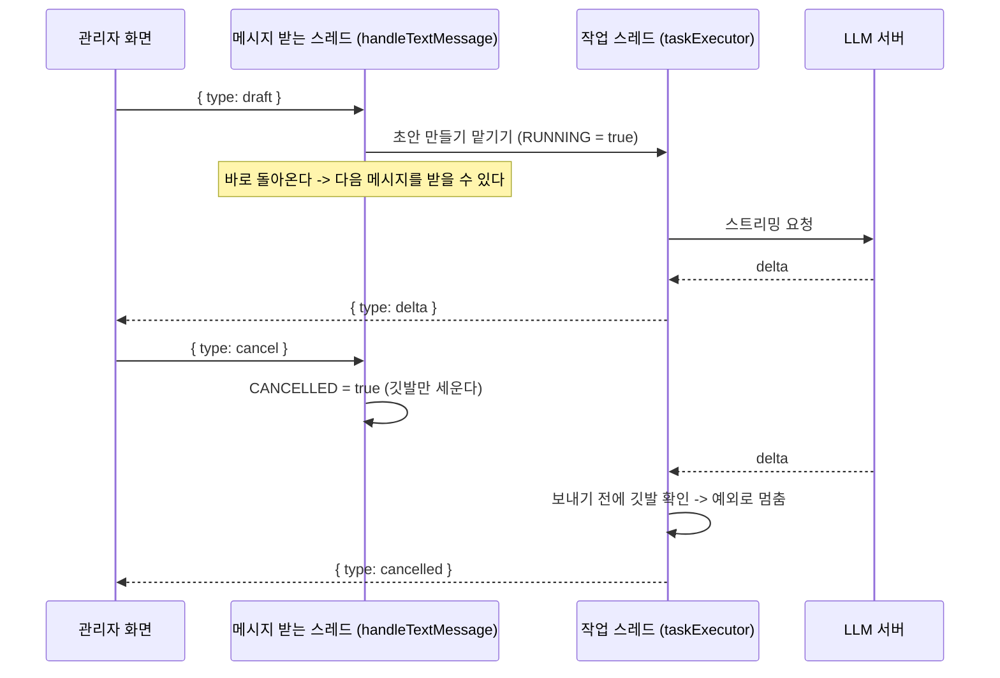

# Phase 3-2: WebSocket 으로 관리자 메뉴 설명 초안 붙이기

## 개요

Phase 3-1 에서는 손님이 묻고 AI 가 답하는 기능을 SSE 로 만들었다.
Phase 3-2 에서는 관리자가 메뉴를 등록 · 수정할 때 **AI 가 메뉴 설명을 써 주는 기능**을 WebSocket 으로 만든다.
글자가 설명 칸에 실시간으로 채워지고, 쓰는 도중에 **[중단]**, 다 쓴 뒤에는 **고칠 점 한 줄**로 다시 쓰게 할 수 있다.

| 구분 | Phase 3-1 | Phase 3-2 |
|---|---|---|
| 의존성 | - | `spring-boot-starter-websocket` |
| 새 주소 | - | `ws://localhost:8080/ws/admin/menu-draft` (관리자 전용, 첫 메시지로 인증) |
| 서버 | `ai` 도메인 (추천 채팅) | + `ai/websocket` 패키지, `MenuDraftService` |
| 화면 | 떠 있는 AI 추천 창 | + 관리자 메뉴 등록 · 수정 화면의 **AI 초안 도우미** |
| 선택 기능 | - | AI 메뉴 사진 만들기 (13장) |

```
phase-3-2/
├─ README.md               실행 방법
├─ HOWTO-PHASE-3-2.md      이 문서
├─ REVIEW.md               복습 체크리스트
├─ spring-server/          Phase 3-1 + WebSocket
└─ react-client/           Phase 3-1 + 관리자 메뉴 화면의 AI 초안 도우미
```

### 이 문서를 읽는 법

- 1~3장은 이론 요약이다. 자세한 이론은 Notion 교안(`7-1. LLM API를 연결하기 위한 SSE와 WebSocket`)에 있고, 장 머리의 콜아웃에 해당 차시와 절을 적어 두었다. 4장부터는 **Phase 3-1 프로젝트를 위에서부터 차례로 고쳐 Phase 3-2 를 완성하는 순서**다.
- 수업을 놓쳤다면 4장부터 순서대로 따라 한다. 코드 블록을 그대로 복사해 붙여넣으면 `phase-3-2` 폴더와 같은 결과가 된다.
- 코드 위에는 무엇을 할지 표시해 두었다.
  - **[새 파일]** : 그 경로에 파일을 새로 만들고 코드 전체를 붙여넣는다.
  - **[전체 교체]** : 기존 파일의 내용을 전부 지우고 코드 전체를 붙여넣는다.
  - **[일부 수정]** : 바꾸기 전 코드를 찾아 바꾼 뒤 코드로 고친다.
  - **[선택]** : 주석이나 문서만 바뀌는 곳이다. 건너뛰어도 동작은 같다.
- **13장(AI 메뉴 사진 만들기)은 선택 기능이다.** 12장까지만 해도 메뉴 설명 초안은 모두 동작한다. 14장까지 하면 `phase-3-2` 폴더와 같아진다. (`api-docs.json` 만 다를 수 있다. 14장 참고)
- 실행해 볼 수 있는 지점마다 **확인** 이 있다. 확인이 통과한 뒤 다음으로 넘어간다.
- 막히면 완성본인 `phase-3-2` 폴더의 같은 파일과 비교한다.
- **LLM API 는 호출할 때마다 요금이 나간다.** 초안 1회는 0.1원 안팎이지만, **사진 1장은 10원 안팎**이다. 사진은 필요할 때만 만든다.

서버 쪽 경로는 `spring-server/src/main/java/com/ohgiraffers/restaurant/` 를 줄여 `restaurant/` 로 적는다.

---

## 1. WebSocket 기초

> 자세한 설명 : Notion `3. 실시간 통신 방식 비교`, `5. WebSocket 양방향 통신` 목차 1·4·6

### 1-1. HTTP 로 시작해서 계속 열려 있는 연결

HTTP 는 요청 하나에 응답 하나를 받으면 끝난다. WebSocket 은 **처음 한 번만 HTTP 요청**으로 시작하고, 그 뒤로는 연결을 끊지 않고 브라우저와 서버가 **서로 아무 때나** 메시지를 보낸다.

```
GET /ws/admin/menu-draft HTTP/1.1
Host: localhost:8080
Upgrade: websocket                  <- WebSocket 으로 바꾸자
Connection: Upgrade
Origin: http://localhost:5173
Sec-WebSocket-Key: dGhlIHNhbXBsZSBub25jZQ==

HTTP/1.1 101 Switching Protocols    <- 좋다. 지금부터 이 연결은 WebSocket 이다
Upgrade: websocket
Connection: Upgrade
```

이 첫 요청 · 응답을 **핸드셰이크**라고 한다. 주소는 `http://` 대신 `ws://` (HTTPS 서버라면 `wss://`)로 쓴다.

### 1-2. 폴링 · SSE · WebSocket

| 방법 | 방향 | 연결 | 이 프로젝트 |
|---|---|---|---|
| 폴링 | 브라우저가 계속 물어봄 | 요청마다 새로 | - |
| SSE | 서버 -> 브라우저 (한 방향) | 응답 하나를 끝내지 않고 이어서 보낸다 | 3-1 손님 추천 채팅 |
| **WebSocket** | **양방향** | 연결 하나를 열어 두고 서로 보낸다 | **3-2 관리자 메뉴 설명 초안** |

### 1-3. 주소 대신 `type`

HTTP 는 `POST /api/ai/recommendations` 처럼 **주소와 메서드**로 무엇을 할지 구분했다.
WebSocket 은 연결이 하나뿐이라 주소가 하나다. 그래서 메시지마다 **`type`** 을 넣어 무슨 메시지인지 구분한다.

```
관리자 -> 서버 : { "type": "draft", "menuName": "마라 크림 떡볶이", ... }
서버 -> 관리자 : { "type": "delta", "text": "마라의" }
서버 -> 관리자 : { "type": "delta", "text": " 얼얼함에" }
관리자 -> 서버 : { "type": "cancel" }
서버 -> 관리자 : { "type": "cancelled" }
```

| 관리자 -> 서버 | 뜻 | 서버 -> 관리자 | 뜻 |
|---|---|---|---|
| `auth` | 토큰 보내기 (첫 메시지) | `auth_ok` | 인증 성공 |
| `draft` | 메뉴 정보로 초안 쓰기 | `delta` | 초안 글자 조각 |
| `revise` | 고칠 점으로 다시 쓰기 | `done` | 초안 완성 |
| `cancel` | 쓰는 중인 것 멈추기 | `cancelled` | 멈춤 |
| | | `error` | 실패 (인증 실패면 연결도 닫힌다) |

### 1-4. 닫힘 코드

연결을 닫는 쪽은 상대에게 **닫힌 이유를 숫자로** 알린다. HTTP 의 상태 코드(200, 401)와 같은 역할이다.
브라우저는 `onclose` 의 `event.code` 로, 서버는 `afterConnectionClosed` 의 `status.getCode()` 로 받는다.

| 코드 | 뜻 | 이 프로젝트에서 |
|---|---|---|
| 1000 | 정상 종료 | 다른 화면으로 가서 화면 코드가 `close()` 를 호출했다 |
| 1001 | 한쪽이 떠남 | 새로고침하거나 탭을 닫아 브라우저가 닫았다 |
| 1006 | 비정상 끊김 (닫힘 코드 없이 끊김) | 네트워크가 끊기거나 서버가 갑자기 꺼졌다 |
| 1008 | 규칙 위반 | 토큰이 틀리거나 관리자가 아니어서 **서버가 일부러** 닫았다 |

인증 실패를 그냥 닫으면 1000(정상 종료)이 되어 화면이 끊긴 이유를 구분할 수 없다. 1008 로 닫으면 `event.code` 만 보고도 "다시 로그인" 같은 처리를 할 수 있다.

---

## 2. SSE 대신 WebSocket 을 쓴 이유

> 자세한 설명 : Notion `3. 실시간 통신 방식 비교` 목차 4-3, `5. WebSocket 양방향 통신` 목차 7-1



- **도중에 끼어들기** : 초안을 쓰는 도중에 관리자가 [중단]을 보낼 수 있다. SSE 는 서버 -> 브라우저 한 방향이라 응답 중에 브라우저가 무언가를 보낼 수 없다.
- **연결 하나로 계속 주고받기** : 초안 -> 다시 쓰기 -> 다시 쓰기 ... 를 같은 연결로 한다.
- 반대로 손님 추천 채팅(3-1)은 질문 하나에 답 하나로 끝나는 구조라, 평범한 HTTP 위에서 동작하는 SSE 가 더 단순하다.

### 서버가 기억하는 대화

| | 3-1 추천 채팅 (SSE) | 3-2 메뉴 설명 초안 (WebSocket) |
|---|---|---|
| 대화 기록을 누가 들고 있나 | **React** (`messages` state) | **서버** (연결마다 하나씩) |
| 요청마다 보내는 것 | 지금까지의 대화 전체 | 이번 메시지 하나 (`더 짧게`) |
| 대화가 사라지는 때 | 로그아웃할 때 | 연결이 닫힐 때 (화면을 떠날 때) |

LLM 서버는 대화를 기억하지 않으므로(3-1 의 1장), 어느 쪽이든 LLM API 에는 매번 대화 전체를 보낸다. 다른 점은 **우리 서버와 브라우저 사이**에서 누가 대화를 들고 있느냐다.

---

## 3. WebSocket 과 인증

> 자세한 설명 : Notion `5. WebSocket 양방향 통신` 목차 5

Phase 2 에서는 모든 요청의 `Authorization: Bearer ...` 헤더로 로그인한 사람을 확인했다.
그런데 **브라우저의 `new WebSocket()` 은 헤더를 붙일 수 없다.** 핸드셰이크 요청을 브라우저가 알아서 만들기 때문이다.

| 방법 | 문제 |
|---|---|
| 주소에 붙이기 `ws://...?token=eyJ...` | 주소는 서버 접속 로그 · 브라우저 기록에 남는다. 토큰이 남으면 누구나 그 토큰으로 관리자 행세를 할 수 있다 |
| 쿠키 | Phase 2 는 토큰을 쿠키가 아닌 localStorage 에 두었다 |
| **첫 메시지로 보내기** | 연결은 누구나 열 수 있지만, 첫 메시지(`auth`)로 토큰을 검증하기 전에는 아무것도 해 주지 않는다. **이 방법을 쓴다** |



토큰을 검증하는 코드는 Phase 2 의 `JwtTokenProvider.parseAccessToken()` 을 그대로 쓴다. 바뀌는 것은 **토큰을 어디서 꺼내느냐** 뿐이다. (헤더 -> 첫 메시지)

---

## 4. 시작 전 준비

### 4-1. Phase 3-1 이 동작하는지 확인

- `phase-3-1/spring-server` 를 실행하면 콘솔에 `[OpenAiClient] OPENAI_API_KEY 확인됨` 이 찍힌다.
- `phase-3-1/react-client` 에서 `npm run dev` 를 실행하고, 로그인한 뒤 AI 추천 창으로 추천을 받을 수 있다.
- 관리자 계정 `admin / admin1234` 로 로그인하면 헤더에 **메뉴 관리** 가 보인다.

### 4-2. 작업할 폴더 만들기

Phase 3-1 은 그대로 두고, 복사본을 고쳐 Phase 3-2 를 만든다.

1. 새 폴더를 하나 만든다. (예: `my-phase-3-2`)
2. `phase-3-1` 의 `spring-server` 와 `react-client` 폴더를 새 폴더 안에 복사한다.
   아래는 복사하지 않는다. 빌드 결과물이거나 IntelliJ 가 프로젝트를 열 때 다시 만드는 파일이다.
   - `spring-server` : `build`, `.gradle`, `.idea`, `ohgi-restaurant.iml`
   - `react-client` : `node_modules`, `dist`
3. 터미널에서 새 폴더의 `react-client` 로 이동해 `npm install` 을 실행한다.
4. IntelliJ 에서 **File > Open** 으로 새 폴더의 `spring-server` 를 연다. 프로젝트 SDK 가 21 인지 확인한다. (3-1 의 4-3)

> **주의.** 모든 Phase 의 서버가 같은 8080 포트를 쓴다. 한 번에 하나만 실행한다.

---

## 5. 의존성과 설정

### 5-1. WebSocket 의존성

**[일부 수정]** `spring-server/build.gradle` 의 `dependencies { }` 블록

바꾸기 전

```groovy
    runtimeOnly 'io.jsonwebtoken:jjwt-jackson:0.13.0'
```

바꾼 뒤

```groovy
    runtimeOnly 'io.jsonwebtoken:jjwt-jackson:0.13.0'

    /* 설명. [Phase 3-2] WebSocket. 관리자 화면과 서버가 연결 하나를 열어 두고 서로 아무 때나 메시지를 보낸다. */
    implementation 'org.springframework.boot:spring-boot-starter-websocket'
```

Gradle 창의 새로고침(Reload All Gradle Projects)을 누른다.

### 5-2. 초안용 모델 설정

**[일부 수정]** `spring-server/src/main/resources/application.yaml` 의 `openai:` 블록

3-1 에서 기능마다 모델 · 출력 상한 · 추론 정도를 따로 정해 두었다. 초안(`draft`)을 한 줄씩 더한다.

바꾸기 전

```yaml
  model:
    # 손님의 AI 추천 채팅에서 검색 조건 뽑기 (구조화 출력)
    extract: gpt-6-luna
    # 손님에게 응답할 추천 문장 만들기 (스트리밍)
    chat: gpt-6-luna
  # 한 번에 만들 수 있는 최대 출력 토큰. 토큰 비용의 상한이다.
  max-output-tokens:
    extract: 300
    chat: 800
  # 추론 모델이 응답하기 전에 '생각'하는 정도. (생각한 토큰도 돈과 시간이 든다)
  # 모델마다 선택할 수 있는 값이 다르고, 추론 기능이 없는 모델(gpt-4.1-nano 등)은 비워 둔다.
  reasoning-effort:
    extract: none
    chat: none
```

바꾼 뒤

```yaml
  model:
    # 손님의 AI 추천 채팅에서 검색 조건 뽑기 (구조화 출력)
    extract: gpt-6-luna
    # 손님에게 응답할 추천 문장 만들기 (스트리밍)
    chat: gpt-6-luna
    # [Phase 3-2] 관리자 메뉴 설명 초안 (WebSocket 으로 스트리밍)
    draft: gpt-6-luna
  # 한 번에 만들 수 있는 최대 출력 토큰. 토큰 비용의 상한이다.
  max-output-tokens:
    extract: 300
    chat: 800
    draft: 400
  # 추론 모델이 응답하기 전에 '생각'하는 정도. (생각한 토큰도 돈과 시간이 든다)
  # 모델마다 선택할 수 있는 값이 다르고, 추론 기능이 없는 모델(gpt-4.1-nano 등)은 비워 둔다.
  reasoning-effort:
    extract: none
    chat: none
    draft: none
```

메뉴 설명은 200자 이내라 출력 상한을 400 토큰으로 낮게 잡았다.

[선택] 파일 맨 위 주석의 `Phase 3-1 설정 (Spring Security + JWT + OpenAI 추천 채팅)` 을 `Phase 3-2 설정 (Spring Security + JWT + OpenAI 추천 채팅 + 메뉴 설명 초안)` 으로 바꾼다.

---

## 6. 메시지 DTO : `MenuDraftMessage`

WebSocket 으로 오가는 JSON 을 담을 클래스다. 1-3 의 표처럼 `type` 마다 쓰는 필드가 다르지만, 클래스 하나에 모두 두고 `type` 에 맞는 필드만 채워 보낸다.

**[새 파일]** `restaurant/ai/dto/MenuDraftMessage.java`

```java
package com.ohgiraffers.restaurant.ai.dto;

/* 설명. [Phase 3-2] 관리자 화면이 WebSocket 으로 보내는 메시지 (JSON 한 덩어리)
 *  ----------------------------------------------------------------------------------
 *  WebSocket 에는 HTTP 처럼 주소(URL)나 메서드(GET/POST)가 없다. 연결 하나로 모든 메시지가 오가므로,
 *  메시지마다 type 을 적어 '무엇을 해 달라는 메시지인지'를 구분한다.
 *  ----------------------------------------------------------------------------------
 *  type    | 쓰는 필드                                        | 뜻
 *  auth    | token                                            | 연결 직후 한 번. 토큰으로 관리자인지 확인한다
 *  draft   | menuName, categoryName, menuPrice, menuIngredients | 이 메뉴의 설명 초안을 써 달라
 *  revise  | instruction                                      | 방금 쓴 초안을 이렇게 고쳐 달라 (예: 더 짧게)
 *  cancel  | -                                                | 만들고 있는 초안을 멈춰 달라
 *  image   | menuName, categoryName, menuIngredients, menuDescription | [선택] 메뉴 사진을 만들어 달라
 * */
public class MenuDraftMessage {

    private String type;
    private String token;
    private String menuName;
    private String categoryName;
    private Integer menuPrice;
    private String menuIngredients;
    private String instruction;
    private String menuDescription;

    public MenuDraftMessage() {}

    public String getType() {
        return type;
    }

    public void setType(String type) {
        this.type = type;
    }

    public String getToken() {
        return token;
    }

    public void setToken(String token) {
        this.token = token;
    }

    public String getMenuName() {
        return menuName;
    }

    public void setMenuName(String menuName) {
        this.menuName = menuName;
    }

    public String getCategoryName() {
        return categoryName;
    }

    public void setCategoryName(String categoryName) {
        this.categoryName = categoryName;
    }

    public Integer getMenuPrice() {
        return menuPrice;
    }

    public void setMenuPrice(Integer menuPrice) {
        this.menuPrice = menuPrice;
    }

    public String getMenuIngredients() {
        return menuIngredients;
    }

    public void setMenuIngredients(String menuIngredients) {
        this.menuIngredients = menuIngredients;
    }

    public String getInstruction() {
        return instruction;
    }

    public void setInstruction(String instruction) {
        this.instruction = instruction;
    }

    public String getMenuDescription() {
        return menuDescription;
    }

    public void setMenuDescription(String menuDescription) {
        this.menuDescription = menuDescription;
    }
}
```

`menuDescription` 은 13장(선택)의 사진 만들기에서 쓴다.

---

## 7. 초안 로직 : `MenuDraftService`

> 자세한 설명 : Notion `2. 구조화 출력과 프롬프트 설계` 목차 3-4, `5. WebSocket 양방향 통신` 목차 7-1

3-1 의 `OpenAiClient.streamText()` 를 그대로 쓴다. 다른 점은 **대화 기록(`history`)을 매개변수로 받는다**는 것이다. 기록은 연결마다 하나씩 핸들러(8장)가 들고 있다가 넘겨준다.

**[새 파일]** `restaurant/ai/service/MenuDraftService.java`

```java
package com.ohgiraffers.restaurant.ai.service;

import com.ohgiraffers.restaurant.ai.client.OpenAiClient;
import com.ohgiraffers.restaurant.ai.dto.ChatMessage;
import com.ohgiraffers.restaurant.ai.dto.MenuDraftMessage;
import org.springframework.beans.factory.annotation.Value;
import org.springframework.stereotype.Service;

import java.util.ArrayList;
import java.util.List;
import java.util.function.Consumer;

/* 설명. [Phase 3-2] 관리자용 메뉴 설명 초안
 *  ----------------------------------------------------------------------------------
 *  메뉴 이름, 카테고리, 가격, 재료를 보고 메뉴 상세설명(tbl_menu.menu_description)의 초안을 쓴다.
 *  답은 스트리밍으로 받고, 글자 조각마다 onDelta 를 호출해 WebSocket 으로 바로 보낸다. (MenuDraftWebSocketHandler 참고)
 *  ----------------------------------------------------------------------------------
 *  대화 기록(history)을 서버가 들고 있다는 점이 3-1 의 추천 채팅과 다르다.
 *  - 3-1 (SSE)       : 요청 하나가 끝나면 연결도 끝난다. 그래서 React 가 대화를 들고 있다가 매번 다시 보낸다.
 *  - 3-2 (WebSocket) : 연결이 계속 열려 있다. 연결마다 대화를 서버에 두면, '더 짧게'만 보내도 무엇을 고칠지 안다.
 *  history 는 연결(WebSocket 세션)마다 하나씩 따로 만들어 핸들러가 보관한다.
 *  ----------------------------------------------------------------------------------
 *  이 서비스는 핸들러와 OpenAiClient 사이에 있다. 핸들러가 넘긴 onDelta(조각마다 할 일)를 OpenAiClient 까지 전달한다.
 *  주석의 [Client 호출] 은 OpenAiClient 로 넘어가는 곳, [보조 메서드] 는 이 클래스 안의 메서드를 호출하는 곳이다.
 * */
@Service
public class MenuDraftService {

    // 서버에 들고 있을 최근 대화 개수 (초안을 여러 번 고쳐도 입력 토큰이 끝없이 늘지 않게)
    private static final int MAX_MESSAGES = 8;

    // AI 에게 줄 지시문(시스템 프롬프트). 기존 메뉴 설명과 문체, 길이가 같아지도록 예시 문장을 넣었다.
    private static final String INSTRUCTIONS = """
            너는 '오지라퍼 레스토랑'의 메뉴판 문구를 쓰는 직원이다. 메뉴 정보를 보고 메뉴 상세설명을 쓴다.
            - 2~3문장, 200자 이내로 쓴다.
            - 문장은 '~다.'로 끝낸다. (예: 에스프레소에 열무김치 국물을 더한 라떼다.)
            - 재료에 없는 재료를 지어내지 않는다. 건강 효능을 과장하지 않는다.
            - 맛 · 식감 · 어울리는 상황 중 손님이 고르는 데 도움이 되는 것을 담는다.
            - 수정을 부탁받으면 직전 설명을 그 요청대로 고쳐 쓴다.
            - 설명 문장만 답한다. 인사말, 따옴표, 마크다운 기호를 붙이지 않는다.
            """;

    // OpenAI 를 호출하는 부품 (3-1 과 같은 것)
    private final OpenAiClient openAiClient;
    // application.yaml 의 openai.*.draft 값
    private final String model;
    private final int maxOutputTokens;
    private final String reasoningEffort;

    public MenuDraftService(OpenAiClient openAiClient,
                            @Value("${openai.model.draft}") String model,
                            @Value("${openai.max-output-tokens.draft}") int maxOutputTokens,
                            @Value("${openai.reasoning-effort.draft:}") String reasoningEffort) {
        this.openAiClient = openAiClient;
        this.model = model;
        this.maxOutputTokens = maxOutputTokens;
        this.reasoningEffort = reasoningEffort;
    }

    /* 설명. API 키가 설정되어 있는지 확인 용도. 핸들러는 OpenAiClient 를 직접 모르므로 이 서비스를 통해 물어본다. */
    public boolean isEnabled() {
        // [Client 호출] isEnabled() : 키가 있는지만 확인한다. (OpenAI 서버에 요청을 보내지는 않는다)
        return openAiClient.isEnabled();
    }

    /* 목차. 1. 첫 초안 */
    /**
     * 메뉴 정보로 첫 초안을 쓴다. 이전 대화는 지우고 새로 시작한다.
     *
     * @param history 이 연결의 대화 기록 (이 메서드가 채운다)
     * @return 완성된 초안 전체
     */
    public String draft(List<ChatMessage> history, MenuDraftMessage menu, Consumer<String> onDelta) {

        // [AI 초안 쓰기]를 다시 누르면 새 메뉴 정보로 처음부터 시작한다
        history.clear();
        // 메뉴 정보를 대화의 첫 번째 user 메시지로 넣는다. (오래된 대화를 버릴 때도 이 첫 메시지는 남긴다, generate 참고)
        history.add(new ChatMessage("user", """
                다음 메뉴의 상세설명을 써 줘.
                - 메뉴 이름 : %s
                - 카테고리 : %s
                - 가격 : %s
                - 재료 : %s""".formatted(
                menu.getMenuName(),
                // [보조 메서드] orNone() : 비어 있는 값은 '정하지 않음'으로 적는다
                orNone(menu.getCategoryName()),
                menu.getMenuPrice() == null ? "정하지 않음" : menu.getMenuPrice() + "원",
                orNone(menu.getMenuIngredients()))));

        System.out.println("[MenuDraftService] 초안 요청 : " + menu.getMenuName());
        // [보조 메서드] generateOrRollback() : OpenAI 에 보내 초안을 받는다. 실패하면 방금 넣은 메시지를 되돌린다.
        return generateOrRollback(history, onDelta);
    }

    /* 목차. 2. 고쳐 쓰기 */
    /**
     * 직전 초안을 지시대로 고친다. 서버가 대화를 들고 있으므로 지시 한 줄만 받으면 된다.
     */
    public String revise(List<ChatMessage> history, String instruction, Consumer<String> onDelta) {

        // 고칠 점 한 줄을 대화 끝에 더한다. 앞의 메뉴 정보와 직전 초안은 이미 history 에 있다.
        history.add(new ChatMessage("user", instruction));

        System.out.println("[MenuDraftService] 고쳐 쓰기 요청 : " + instruction + " (대화 " + history.size() + "개)");
        // [보조 메서드] generateOrRollback() : 대화 전체를 보내 고친 초안을 받는다
        return generateOrRollback(history, onDelta);
    }

    /* 설명. 중간에 멈추거나 실패하면 방금 넣은 요청을 대화 기록에서 뺀다.
     *  답이 없는 요청이 남아 있으면, 다음 고쳐 쓰기 때 AI 가 무엇을 고쳐야 할지 헷갈린다.
     * */
    private String generateOrRollback(List<ChatMessage> history, Consumer<String> onDelta) {
        try {
            // [보조 메서드] generate() : 실제로 OpenAI 를 호출한다
            return generate(history, onDelta);
        } catch (RuntimeException e) {
            // [중단]이나 실패로 끝났다. 방금 넣은 요청(마지막 항목)을 뺀다
            history.remove(history.size() - 1);
            // 예외는 그대로 다시 던져 핸들러가 cancelled 또는 error 메시지를 보내게 한다
            throw e;
        }
    }

    /* 설명. 대화 기록을 보내고 답을 스트리밍으로 받는다. 다 받으면 답도 대화 기록에 넣는다. */
    private String generate(List<ChatMessage> history, Consumer<String> onDelta) {

        // 오래된 대화는 버린다. 단, 맨 처음의 메뉴 정보는 남겨 둬야 무엇에 대한 설명인지 잊지 않는다.
        while (history.size() > MAX_MESSAGES) {
            history.remove(1);
        }

        // 조각을 이어 붙여 완성된 초안을 모아 둘 곳
        StringBuilder text = new StringBuilder();
        // [Client 호출] streamText() : 지시문과 대화 기록을 보내고, 응답을 글자 조각으로 나눠 받는다.
        //  - 모델, 추론 정도, 출력 상한은 application.yaml 의 openai.*.draft 값이다.
        //  - history 는 복사본을 넘긴다. 원본 대화 기록은 이 클래스에서만 바꾼다.
        //  - 마지막 인자(람다)는 조각이 올 때마다 OpenAiClient 가 호출한다.
        openAiClient.streamText(model, reasoningEffort, INSTRUCTIONS, new ArrayList<>(history), maxOutputTokens,
                delta -> {
                    // 완성본을 모으고
                    text.append(delta);
                    // 핸들러가 넘겨준 onDelta(= 핸들러의 sendDelta)를 호출해 화면으로 보낸다.
                    // [중단]을 받았으면 여기서 예외가 나고, OpenAI 응답 읽기도 함께 멈춘다.
                    onDelta.accept(delta);
                });

        // AI 의 초안도 대화 기록에 넣는다. 다음 고쳐 쓰기 때 '직전 초안'으로 쓰인다.
        history.add(new ChatMessage("assistant", text.toString()));
        // 완성된 초안 전체를 돌려준다. 핸들러가 done 메시지에 담아 보낸다.
        return text.toString();
    }

    /* 설명. 비어 있는 값은 '정하지 않음'으로 바꾼다. (관리자가 아직 입력하지 않은 칸) */
    private String orNone(String value) {
        return value == null || value.isBlank() ? "정하지 않음" : value;
    }
}
```



- **중단 · 실패하면 방금 넣은 요청을 뺀다.** (`generateOrRollback`) 답이 없는 요청이 기록에 남으면 다음 고쳐 쓰기 때 AI 가 무엇을 고칠지 헷갈린다.
- 오래된 대화는 버리되 **맨 처음 메뉴 정보는 남긴다.** (`history.remove(1)`) 버리면 AI 가 무엇에 대한 설명인지 잊는다.

---

## 8. WebSocket 핸들러와 주소 등록

> 자세한 설명 : Notion `5. WebSocket 양방향 통신` 목차 3·4·7

IntelliJ 의 프로젝트 창에서 `restaurant.ai` 를 오른쪽 클릭하고 **New > Package** 로 `websocket` 을 만든다.

### 8-1. `MenuDraftWebSocketHandler`

`TextWebSocketHandler` 를 상속하면 연결의 순간마다 Spring 이 메서드를 호출해 준다.

| 메서드 | 언제 | 여기서 하는 일 |
|---|---|---|
| `afterConnectionEstablished` | 연결이 열렸을 때 | 이 연결의 대화 기록 · 진행 상태를 만든다 |
| `handleTextMessage` | 메시지를 받을 때마다 | `type` 을 보고 인증 · 초안 · 다시 쓰기 · 중단으로 나눈다 |
| `afterConnectionClosed` | 연결이 닫혔을 때 | 만들던 초안을 멈추고 목록에서 뺀다 |

연결마다 따로 둘 값(인증한 관리자, 대화 기록, 진행 상태)은 `session.getAttributes()` 에 넣는다. 연결 하나에 하나씩 있는 `Map` 이다.

**[새 파일]** `restaurant/ai/websocket/MenuDraftWebSocketHandler.java`

```java
package com.ohgiraffers.restaurant.ai.websocket;

import com.ohgiraffers.restaurant.ai.dto.ChatMessage;
import com.ohgiraffers.restaurant.ai.dto.MenuDraftMessage;
import com.ohgiraffers.restaurant.ai.service.MenuDraftService;
import com.ohgiraffers.restaurant.common.security.CustomUserDetails;
import com.ohgiraffers.restaurant.common.security.JwtTokenProvider;
import io.jsonwebtoken.JwtException;
import org.springframework.beans.factory.annotation.Qualifier;
import org.springframework.core.task.TaskExecutor;
import org.springframework.stereotype.Component;
import org.springframework.web.socket.CloseStatus;
import org.springframework.web.socket.TextMessage;
import org.springframework.web.socket.WebSocketSession;
import org.springframework.web.socket.handler.ConcurrentWebSocketSessionDecorator;
import org.springframework.web.socket.handler.TextWebSocketHandler;
import tools.jackson.databind.ObjectMapper;

import java.io.IOException;
import java.io.UncheckedIOException;
import java.util.ArrayList;
import java.util.List;
import java.util.Map;
import java.util.concurrent.ConcurrentHashMap;
import java.util.concurrent.atomic.AtomicBoolean;

/* 설명. [Phase 3-2] 관리자 메뉴 설명 초안 WebSocket (ws://localhost:8080/ws/admin/menu-draft)
 *  ----------------------------------------------------------------------------------
 *  연결 하나가 열려 있는 동안 관리자와 서버가 서로 아무 때나 메시지를 보낸다.
 *      관리자 -> 서버 : auth, draft, revise, cancel   (MenuDraftMessage)  + [선택] image
 *      서버 -> 관리자 : auth_ok, delta, done, cancelled, error           + [선택] image_progress, image
 *  ----------------------------------------------------------------------------------
 *  SSE 대신 WebSocket 을 쓰는 이유
 *  - 초안이 만들어지는 '도중에' 관리자가 [중단]을 보낼 수 있어야 한다. 서버 -> 브라우저 한 방향인 SSE 로는 안 된다.
 *  - 연결 하나로 초안 -> 고쳐 쓰기 -> 고쳐 쓰기 ... 를 계속 주고받는다. 서버가 연결마다 대화를 기억한다.
 *  ----------------------------------------------------------------------------------
 *  인증 : 브라우저의 WebSocket 은 연결할 때 Authorization 헤더를 붙일 수 없다.
 *  주소에 ?token= 으로 붙이면 서버 로그, 브라우저 기록에 토큰이 남으므로,
 *  연결한 뒤 첫 메시지(auth)로 토큰을 보내게 하고 여기서 Phase 2 의 JwtTokenProvider 로 검증한다.
 *  ----------------------------------------------------------------------------------
 *  호출 흐름 : 핸들러 -> MenuDraftService(또는 MenuImageService) -> OpenAiClient
 *  글자 조각은 반대 방향으로 돌아온다. OpenAiClient 가 조각마다 람다를 호출하고, 그 람다가 이 클래스의 sendDelta() 다.
 *  주석의 [Service 호출] 은 서비스로 넘어가는 곳, [보조 메서드] 는 이 클래스 안의 메서드를 호출하는 곳이다.
 * */
@Component
public class MenuDraftWebSocketHandler extends TextWebSocketHandler {

    // 세션(연결)마다 따로 보관하는 값의 이름. WebSocketSession.getAttributes() 에 넣는다.
    // 인증한 관리자 (CustomUserDetails)
    private static final String ADMIN = "admin";
    // 이 연결의 초안 대화 기록 (List<ChatMessage>)
    private static final String HISTORY = "history";
    // 지금 초안을 만드는 중인가 (AtomicBoolean)
    private static final String RUNNING = "running";
    // [중단]을 받았는가 (AtomicBoolean)
    private static final String CANCELLED = "cancelled";

    // 첫 메시지(auth)의 토큰을 검증할 때 쓴다. (Phase 2 에서 만든 것을 그대로 쓴다)
    private final JwtTokenProvider jwtTokenProvider;
    // 메뉴 설명 초안을 만드는 서비스. OpenAI 호출은 이 서비스가 OpenAiClient 에 맡긴다.
    private final MenuDraftService menuDraftService;
    // 받은 JSON 문자열 <-> DTO, 보낼 Map -> JSON 문자열 변환
    private final ObjectMapper objectMapper;
    // 초안 만들기를 맡길 실행기 (가상 스레드). 이유는 handleTextMessage 의 설명 참고
    private final TaskExecutor taskExecutor;

    /* 설명. 열려 있는 연결 목록 (세션 아이디 -> 세션)
     *  WebSocketSession 은 여러 스레드가 동시에 sendMessage() 를 호출하면 안 된다.
     *  초안 조각은 작업 스레드가, 오류, 중단 응답은 메시지를 받은 스레드가 보낼 수 있으므로,
     *  ConcurrentWebSocketSessionDecorator 로 감싸서 보내기가 차례로 이뤄지게 한다.
     * */
    private final Map<String, WebSocketSession> sessions = new ConcurrentHashMap<>();

    public MenuDraftWebSocketHandler(JwtTokenProvider jwtTokenProvider,
                                     MenuDraftService menuDraftService,
                                     ObjectMapper objectMapper,
                                     // Spring Boot 가 만들어 둔 비동기 작업용 실행기 (3-1 의 RecommendationService 와 같은 것)
                                     @Qualifier("applicationTaskExecutor") TaskExecutor taskExecutor) {
        this.jwtTokenProvider = jwtTokenProvider;
        this.menuDraftService = menuDraftService;
        this.objectMapper = objectMapper;
        this.taskExecutor = taskExecutor;
    }

    /* 목차. 1. 연결이 열렸을 때 */
    @Override
    public void afterConnectionEstablished(WebSocketSession session) {

        // 보내기 제한 : 한 번 보내는 데 10초, 보내지 못하고 쌓아 둘 수 있는 양 2MB. 넘으면 느린 연결로 보고 끊는다.
        // (이미지 한 장이 Base64 로 약 200KB 라서 넉넉하게 잡았다)
        sessions.put(session.getId(), new ConcurrentWebSocketSessionDecorator(session, 10_000, 2 * 1024 * 1024));

        // 이 연결 전용 값을 세션 속성에 만들어 둔다. 핸들러 객체는 모든 연결이 함께 쓰므로 필드에 두면 안 된다.
        // 빈 대화 기록 (MenuDraftService 가 채운다)
        session.getAttributes().put(HISTORY, new ArrayList<ChatMessage>());
        // 아직 만드는 중이 아니다
        session.getAttributes().put(RUNNING, new AtomicBoolean(false));
        // 아직 [중단]을 받지 않았다
        session.getAttributes().put(CANCELLED, new AtomicBoolean(false));

        System.out.println("[MenuDraftWebSocketHandler] 연결됨 : 세션 " + session.getId() + " (아직 인증 전)");
    }

    /* 목차. 2. 메시지를 받았을 때 */
    /* 설명. 한 연결의 메시지는 한 번에 하나씩 차례로 이 메서드에 들어온다.
     *  그래서 여기서 초안을 끝까지 만들면(몇 초) 그동안 같은 연결의 다음 메시지([중단])를 받지 못한다.
     *  초안 만들기는 taskExecutor 의 다른 스레드에 맡기고 이 메서드는 바로 돌아온다.
     * */
    @Override
    protected void handleTextMessage(WebSocketSession session, TextMessage message) {

        // 보낼 때는 감싸 둔 세션(차례로 보내기)을 쓴다
        WebSocketSession safeSession = sessions.get(session.getId());
        MenuDraftMessage request;
        try {
            // 받은 JSON 문자열을 DTO 로 바꾼다
            request = objectMapper.readValue(message.getPayload(), MenuDraftMessage.class);
        } catch (RuntimeException e) {
            // JSON 이 아니면 오류를 알리고 끝낸다. 연결은 열어 둔다.  -> type: error
            send(safeSession, Map.of("type", "error", "message", "메시지 형식이 올바르지 않습니다."));
            return;
        }

        // type 이 없으면 빈 문자열로 (아래 switch 의 default 로 간다)
        String type = request.getType() == null ? "" : request.getType();
        System.out.println("[MenuDraftWebSocketHandler] 메시지 받음 : type=" + type + " (세션 " + session.getId() + ")");

        // 인증하기 전에는 auth 말고 어떤 메시지도 받지 않는다.
        if (!type.equals("auth") && session.getAttributes().get(ADMIN) == null) {
            // [보조 메서드] closeWithError() : 이유를 알리고 1008 로 연결을 닫는다
            closeWithError(safeSession, "먼저 auth 메시지로 토큰을 보내야 합니다.");
            return;
        }

        // type 에 따라 나눈다. HTTP 의 '주소 + 메서드' 대신 이 값으로 할 일을 구분한다.
        switch (type) {
            // 토큰 검증
            case "auth" -> authenticate(safeSession, request.getToken());
            // 메뉴 정보로 첫 초안 쓰기
            case "draft" -> startDraft(safeSession, request);
            // 고칠 점 한 줄로 다시 쓰기
            case "revise" -> startRevise(safeSession, request.getInstruction());
            // 만들던 것 멈추기
            case "cancel" -> cancel(safeSession);
            // 그 밖의 type 은 오류로 알린다. 연결은 열어 둔다.  -> type: error
            default -> send(safeSession, Map.of("type", "error", "message", "알 수 없는 type 입니다 : " + type));
        }
    }

    /* 목차. 3. 인증 (첫 메시지) */
    private void authenticate(WebSocketSession session, String token) {

        try {
            // Phase 2 의 토큰 검증을 그대로 쓴다. 서명, 만료가 틀리면 JwtException
            CustomUserDetails user = jwtTokenProvider.parseAccessToken(token == null ? "" : token);

            // 토큰은 올바르지만 관리자가 아니면 닫는다
            if (!"ROLE_ADMIN".equals(user.getMemberRole())) {
                closeWithError(session, "관리자만 쓸 수 있습니다.");
                return;
            }

            // 이 연결은 인증되었다. 연결이 닫힐 때까지 이 값으로 인증 여부를 판단한다.
            session.getAttributes().put(ADMIN, user);
            System.out.println("[MenuDraftWebSocketHandler] 인증 성공 : " + user.getMemberId());
            // 인증이 끝났다고 알린다. 화면은 이것을 받은 뒤에 draft 를 보낸다.  -> type: auth_ok
            send(session, Map.of("type", "auth_ok"));

        } catch (JwtException | IllegalArgumentException e) {
            // 서명이 틀리거나 만료된 토큰이면 닫는다
            closeWithError(session, "유효하지 않은 토큰입니다. 다시 로그인해주세요.");
        }
    }

    /* 목차. 4. 초안 만들기, 고쳐 쓰기 (메시지 받는 스레드에서 실행) */
    private void startDraft(WebSocketSession session, MenuDraftMessage request) {

        // 메뉴 이름이 없으면 무엇에 대한 설명인지 알 수 없다
        if (request.getMenuName() == null || request.getMenuName().isBlank()) {
            send(session, Map.of("type", "error", "message", "메뉴 이름을 먼저 입력해주세요."));
            return;
        }
        // [보조 메서드] run() : 아래 람다(AI 작업)를 작업 스레드에 맡긴다. 람다가 돌려준 Map 이 마지막 메시지가 된다.  -> type: done
        //  [Service 호출] menuDraftService.draft() : 이 연결의 대화 기록과 메뉴 정보로 첫 초안을 만든다.
        //  마지막 인자(delta -> sendDelta(...))는 '조각이 올 때마다 할 일'이다.
        //  이 람다는 MenuDraftService 를 거쳐 OpenAiClient.streamText() 까지 전달되고, 조각마다 거꾸로 호출된다.
        run(session, () -> Map.of("type", "done",
                "text", menuDraftService.draft(history(session), request, delta -> sendDelta(session, delta))));
    }

    private void startRevise(WebSocketSession session, String instruction) {

        // 고칠 점은 한 줄 지시라 200자로 제한한다 (길수록 입력 토큰이 늘어난다)
        if (instruction == null || instruction.isBlank() || instruction.length() > 200) {
            send(session, Map.of("type", "error", "message", "고칠 내용을 200자 이하로 입력해주세요."));
            return;
        }
        // 고칠 초안이 아직 없다
        if (history(session).isEmpty()) {
            send(session, Map.of("type", "error", "message", "먼저 초안을 만들어주세요."));
            return;
        }
        // [보조 메서드] run() : 작업 스레드에 맡긴다.  -> type: done
        //  [Service 호출] menuDraftService.revise() : 대화 기록에 고칠 점을 더해 다시 쓴다. 조각은 startDraft 와 같은 람다로 보낸다.
        run(session, () -> Map.of("type", "done",
                "text", menuDraftService.revise(history(session), instruction, delta -> sendDelta(session, delta))));
    }

    /* 설명. AI 작업 하나를 다른 스레드에서 실행하고, 작업이 돌려준 메시지를 보낸다. 한 연결에서는 한 번에 하나만 만든다. */
    private void run(WebSocketSession session, AiJob job) {

        // [Service 호출] isEnabled() : API 키가 있는지만 확인한다. (MenuDraftService 가 OpenAiClient 에 물어본다)
        if (!menuDraftService.isEnabled()) {
            send(session, Map.of("type", "error", "message", "서버에 OPENAI_API_KEY 가 설정되지 않아 AI 기능을 쓸 수 없습니다."));
            return;
        }

        // [보조 메서드] flag() : 이 연결의 '만드는 중' 깃발을 세션 속성에서 꺼낸다
        AtomicBoolean running = flag(session, RUNNING);
        // compareAndSet : false 일 때만 true 로 바꾸고 성공을 알린다. 이미 만드는 중이면 실패한다.
        if (!running.compareAndSet(false, true)) {
            send(session, Map.of("type", "error", "message", "이미 AI 가 작업하고 있습니다. 끝나거나 중단한 뒤 다시 요청해주세요."));
            return;
        }
        // 지난 [중단] 기록을 지운다
        flag(session, CANCELLED).set(false);

        // 작업을 작업 스레드에 넘긴다. 메시지 받는 스레드는 여기서 바로 돌아가 다음 메시지([중단] 등)를 받을 수 있다.
        taskExecutor.execute(() -> {
            // 여기부터는 작업 스레드에서 실행된다. 가상 스레드를 켰다면 VirtualThread[#..] 로 찍힌다.
            System.out.println("[MenuDraftWebSocketHandler] 작업 스레드 : " + Thread.currentThread());
            try {
                // AI 작업(startDraft, startRevise, startImage 가 넘긴 람다)을 실행하고, 돌려준 마지막 메시지를 보낸다  -> type: done / image
                send(session, job.run());
            } catch (DraftCancelledException e) {
                // [중단]으로 멈췄다  -> type: cancelled
                System.out.println("[MenuDraftWebSocketHandler] 중단됨");
                send(session, Map.of("type", "cancelled"));
            } catch (RuntimeException e) {
                // OpenAI 호출 실패 등. 연결은 열어 둔다  -> type: error
                System.out.println("[MenuDraftWebSocketHandler] 실패 : " + e.getMessage());
                send(session, Map.of("type", "error", "message", String.valueOf(e.getMessage())));
            } finally {
                // 성공, 중단, 실패 모두 '만드는 중'을 푼다
                running.set(false);
            }
        });
    }

    /* 설명. 글자 조각 하나를 보낸다. [중단]을 받았거나 연결이 끊겼으면 예외를 던져 OpenAI 스트림 읽기를 멈춘다. */
    private void sendDelta(WebSocketSession session, String delta) {

        // [보조 메서드] checkCancelled() : 멈춰야 하면 여기서 예외가 나고, OpenAiClient.streamText() 의 읽기도 함께 멈춘다
        checkCancelled(session);
        // 조각을 보낸다. 화면은 받은 글자를 설명 칸에 이어 붙인다.  -> type: delta
        send(session, Map.of("type", "delta", "text", delta));
    }

    /* 설명. [중단]을 받았거나 연결이 닫혔으면 예외를 던진다. (작업 스레드가 스스로 멈추게 하는 방법) */
    private void checkCancelled(WebSocketSession session) {
        if (flag(session, CANCELLED).get() || !session.isOpen()) {
            throw new DraftCancelledException();
        }
    }

    /* 목차. 5. 중단 (메시지 받는 스레드에서 실행) */
    /* 설명. 깃발만 세운다. 작업 스레드가 다음 조각을 보내려다 깃발을 보고 스스로 멈춘다. */
    private void cancel(WebSocketSession session) {

        // 만드는 중일 때만 깃발을 세운다
        if (flag(session, RUNNING).get()) {
            flag(session, CANCELLED).set(true);
            System.out.println("[MenuDraftWebSocketHandler] 중단 요청 받음");
        }
    }

    /* 목차. 6. 연결이 닫혔을 때 */
    @Override
    public void afterConnectionClosed(WebSocketSession session, CloseStatus status) {

        // 만드는 중이었다면 멈춘다. (창을 닫거나 다른 화면으로 가면 연결이 닫힌다)
        Object cancelled = session.getAttributes().get(CANCELLED);
        if (cancelled instanceof AtomicBoolean flag) {
            flag.set(true);
        }
        // 연결 목록에서 뺀다. 세션 속성(대화 기록 등)도 연결과 함께 사라진다.
        sessions.remove(session.getId());

        // 닫힘 코드 : 1000 정상 종료, 1001 새로고침, 탭 닫기, 1008 규칙 위반(인증 실패) 등
        System.out.println("[MenuDraftWebSocketHandler] 연결 닫힘 : 세션 " + session.getId() + " (" + status.getCode() + ")");
    }

    /* 설명. 메시지 하나를 JSON 으로 바꿔 보낸다. 이미 닫힌 연결이면 오류 없이 넘어간다. */
    private void send(WebSocketSession session, Map<String, Object> payload) {

        // 닫힌 연결에는 보내지 않는다
        if (session == null || !session.isOpen()) {
            return;
        }
        try {
            // Map 을 JSON 문자열로 바꿔 텍스트 메시지로 보낸다
            session.sendMessage(new TextMessage(objectMapper.writeValueAsString(payload)));
        } catch (IOException | IllegalStateException e) {
            // 보내는 사이에 끊겼을 수 있다. 로그만 남긴다
            System.out.println("[MenuDraftWebSocketHandler] 보내기 실패 : " + e.getMessage());
        }
    }

    /* 설명. 이유를 알린 뒤 연결을 닫는다. 1008(POLICY_VIOLATION) 은 '규칙을 어긴 연결'이라는 표준 닫기 코드다. */
    private void closeWithError(WebSocketSession session, String message) {

        System.out.println("[MenuDraftWebSocketHandler] 연결을 닫는다 : " + message);
        // 먼저 이유를 문장으로 알리고  -> type: error
        send(session, Map.of("type", "error", "message", message));
        try {
            // 1008 로 닫는다. 화면은 onclose 의 event.code 로 이유를 구분할 수 있다.
            session.close(CloseStatus.POLICY_VIOLATION.withReason("unauthorized"));
        } catch (IOException ignored) {
            // 이미 닫혔다.
        }
    }

    /* 설명. 이 연결의 대화 기록을 세션 속성에서 꺼낸다. (afterConnectionEstablished 에서 만들어 둔 것) */
    @SuppressWarnings("unchecked")
    private List<ChatMessage> history(WebSocketSession session) {
        return (List<ChatMessage>) session.getAttributes().get(HISTORY);
    }

    /* 설명. 이 연결의 깃발(RUNNING, CANCELLED)을 세션 속성에서 꺼낸다. */
    private AtomicBoolean flag(WebSocketSession session, String name) {
        return (AtomicBoolean) session.getAttributes().get(name);
    }

    /* 설명. AI 작업 (끝나면 화면에 보낼 마지막 메시지를 돌려준다. 예: done, image) */
    @FunctionalInterface
    private interface AiJob {
        Map<String, Object> run();
    }

    /* 설명. [중단]으로 멈췄음을 알리는 내부용 예외 */
    private static class DraftCancelledException extends UncheckedIOException {
        DraftCancelledException() {
            super(new IOException("관리자가 중단했다"));
        }
    }
}
```

주석에 보이는 image 이야기(메시지 목록의 `[선택] image`, 2MB 보내기 제한 등)는 13장의 선택 기능이다. 코드는 13장에서 더한다.

**[중단]이 동작하는 원리**

한 연결의 메시지는 **한 번에 하나씩 차례로** `handleTextMessage` 에 들어온다. 이 메서드에서 초안을 끝까지 만들면(몇 초) 그동안 같은 연결의 [중단] 메시지를 받지 못한다.



- 작업은 3-1 과 같은 `applicationTaskExecutor`(가상 스레드)에 맡긴다.
- **멈추라고 스레드를 강제로 끄지 않는다.** 깃발(`AtomicBoolean`)만 세우고, 작업 스레드가 다음 조각을 보내기 전에 깃발을 보고 스스로 예외를 던져 멈춘다. 예외가 `OpenAiClient` 의 스트림 읽기를 끝내므로 LLM 서버의 응답도 더 받지 않는다.
- 작업 스레드(조각)와 메시지 받는 스레드(오류 응답)가 **한 연결에 동시에 보낼 수 있다.** `WebSocketSession` 은 동시에 보내면 안 되므로 `ConcurrentWebSocketSessionDecorator` 로 감싼다.
- `compareAndSet(false, true)` : 이미 만드는 중이면 실패한다. 한 연결에서 두 초안이 섞여 오지 않게 막는다.

### 8-2. `WebSocketConfig`

**[새 파일]** `restaurant/ai/websocket/WebSocketConfig.java`

```java
package com.ohgiraffers.restaurant.ai.websocket;

import org.springframework.context.annotation.Configuration;
import org.springframework.web.socket.config.annotation.EnableWebSocket;
import org.springframework.web.socket.config.annotation.WebSocketConfigurer;
import org.springframework.web.socket.config.annotation.WebSocketHandlerRegistry;

/* 설명. [Phase 3-2] WebSocket 주소 등록
 *  ----------------------------------------------------------------------------------
 *  WebSocket 은 처음에 평범한 HTTP GET 요청으로 시작한다. ('Upgrade: websocket' 헤더를 붙여 보낸다)
 *  서버가 101 Switching Protocols 로 답하면 그때부터 같은 연결이 WebSocket 으로 바뀌어 계속 열려 있다.
 *  이 클래스는 '어떤 주소로 들어온 연결을 어떤 핸들러가 맡을지'를 정한다.
 *  ----------------------------------------------------------------------------------
 *  메시지 브로커(STOMP)는 쓰지 않는다. 기능이 하나뿐이라 핸들러 하나가 메시지를 직접 받는 순수 WebSocket 으로 충분하다.
 * */
@Configuration
@EnableWebSocket
public class WebSocketConfig implements WebSocketConfigurer {

    private final MenuDraftWebSocketHandler menuDraftWebSocketHandler;

    public WebSocketConfig(MenuDraftWebSocketHandler menuDraftWebSocketHandler) {
        this.menuDraftWebSocketHandler = menuDraftWebSocketHandler;
    }

    @Override
    public void registerWebSocketHandlers(WebSocketHandlerRegistry registry) {
        registry.addHandler(menuDraftWebSocketHandler, "/ws/admin/menu-draft")
                // CorsConfig(HTTP 요청용)와 따로 정한다. 다른 출처의 화면이 연결하지 못하게 React 주소만 허용한다.
                .setAllowedOrigins("http://localhost:5173");
    }
}
```

- `setAllowedOrigins` : 핸드셰이크 요청의 `Origin` 헤더를 확인한다. React 주소에서 연 연결만 받는다. 인증은 첫 메시지로 하지만, 그 전에 다른 사이트의 화면이 연결 자체를 열지 못하게 한 겹 더 막는다. (`CorsConfig` 는 HTTP 요청에만 적용된다)
- 수업 자료나 블로그에서 자주 보이는 **STOMP**(`@EnableWebSocketMessageBroker`)는 채팅방처럼 여러 사람에게 메시지를 나눠 보낼 때 쓴다. 이번 기능은 관리자 한 명과 서버만 주고받으므로 쓰지 않는다.

**확인.** **Build > Build Project** 로 컴파일 오류가 없는지 본다.

---

## 9. 보안 규칙

> 자세한 설명 : Notion `5. WebSocket 양방향 통신` 목차 5-4

핸드셰이크도 HTTP 요청이므로 Spring Security 의 필터 체인을 지난다. 3장에서 본 것처럼 이 요청에는 토큰이 없으므로, 주소를 열어 두고 인증은 핸들러가 한다.

**[일부 수정]** `restaurant/common/security/SecurityConfig.java` 의 `3-6. AI(ai)` 블록

바꾸기 전

```java
                        .requestMatchers(HttpMethod.POST, "/api/ai/recommendations").authenticated()
```

바꾼 뒤

```java
                        .requestMatchers(HttpMethod.POST, "/api/ai/recommendations").authenticated()
                        /* 설명. [Phase 3-2] 관리자 메뉴 설명 초안 WebSocket
                         *  연결을 여는 HTTP 요청(핸드셰이크)에는 브라우저가 Authorization 헤더를 붙일 수 없다.
                         *  그래서 여기서는 열어 두고, 연결한 뒤 첫 메시지(auth)의 토큰으로 MenuDraftWebSocketHandler 가
                         *  관리자인지 확인한다. 인증하지 않은 연결은 핸들러가 바로 닫는다.
                         * */
                        .requestMatchers("/ws/admin/menu-draft").permitAll()
```

> **참고.** 이 줄이 없으면 핸드셰이크가 맨 아래 블록(3-7)의 `anyRequest()` 규칙에 걸려 **401** 로 거절된다. 브라우저 콘솔에는 이유 없이 `WebSocket connection to ... failed` 만 찍힌다.

[선택] `restaurant/common/config/OpenApiConfig.java` 의 `version = "phase-3-1"` 을 `version = "phase-3-2"` 로 바꾼다.

---

## 10. 확인 : 브라우저 콘솔로 메시지 주고받기

화면을 만들기 전에, 브라우저 콘솔에서 직접 WebSocket 을 열어 1-3 의 메시지가 실제로 오가는지 본다.

1. 서버를 다시 실행한다. 콘솔에 `OPENAI_API_KEY 확인됨` 이 찍힌다.
2. `npm run dev` 로 React 를 실행하고 `http://localhost:5173` 에서 **`user01 / user1234`** 로 로그인한다.
3. F12 > **Console** 탭에 아래를 붙여넣고 Enter 를 누른다. (Chrome 이 붙여넣기를 막으면 `allow pasting` 을 먼저 입력한다)

```js
const token = JSON.parse(localStorage.getItem('ohgi-auth')).state.accessToken;
const ws = new WebSocket('ws://localhost:8080/ws/admin/menu-draft');
ws.onmessage = (event) => console.log('받음', event.data);
ws.onclose = (event) => console.log('닫힘', event.code);
ws.onopen = () => ws.send(JSON.stringify({ type: 'auth', token }));
```

일반 회원이라 거절되고 1008 로 닫힌다. (1-4 참고)
JSON 의 필드 순서는 실행할 때마다 다를 수 있다. 순서는 의미가 없다.

```
받음 {"message":"관리자만 쓸 수 있습니다.","type":"error"}
닫힘 1008
```

4. 로그아웃하고 **`admin / admin1234`** 로 다시 로그인한 뒤, 위 코드를 다시 실행한다.

```
받음 {"type":"auth_ok"}
```

5. 이어서 초안을 요청한다.

```js
ws.send(JSON.stringify({ type: 'draft', menuName: '마라 크림 떡볶이', categoryName: '한식', menuPrice: 9500, menuIngredients: '떡, 마라 소스, 생크림, 치즈, 청경채' }));
```

```
받음 {"text":"…","type":"delta"}
... (글자 조각마다 delta 가 수십 번 온다)
받음 {"text":"쫄깃한 떡과 청경채에 마라 소스의 얼얼한 풍미, 생크림과 치즈의 부드럽고 고소한 맛을 더한 떡볶이다. 매콤한 맛과 크리미한 풍미를 함께 즐기고 싶을 때 어울린다.","type":"done"}
```

6. 고칠 점을 보낸다. 메뉴 정보를 다시 보내지 않았는데도 같은 메뉴의 설명을 고친다. (답은 실행할 때마다 다르다)

```js
ws.send(JSON.stringify({ type: 'revise', instruction: '한 문장으로 짧게' }));
```

```
받음 {"text":"…","type":"delta"}
...
받음 {"text":"얼얼한 마라 소스에 생크림과 치즈를 더해 부드럽고 고소하게 즐기는 떡볶이다.","type":"done"}
```

7. `ws.close()` 로 닫는다.

서버 콘솔에는 이렇게 찍힌다.

```
[MenuDraftWebSocketHandler] 연결됨 : 세션 0e94a776-6772-4e1c-80ed-f795d600fb5f (아직 인증 전)
[MenuDraftWebSocketHandler] 메시지 받음 : type=auth (세션 0e94a776-6772-4e1c-80ed-f795d600fb5f)
[MenuDraftWebSocketHandler] 인증 성공 : admin
[MenuDraftWebSocketHandler] 메시지 받음 : type=draft (세션 0e94a776-6772-4e1c-80ed-f795d600fb5f)
[MenuDraftWebSocketHandler] 작업 스레드 : VirtualThread[#126,task-1]/runnable@ForkJoinPool-1-worker-16
[MenuDraftService] 초안 요청 : 마라 크림 떡볶이
[OpenAiClient] 요청 (스트리밍) : model=gpt-6-luna
[OpenAiClient] 스트리밍 조각 66개 받음
[OpenAiClient] 완료 : model=gpt-6-luna, 입력 토큰=251, 출력 토큰=77 (그중 추론 0), 2779ms
[MenuDraftWebSocketHandler] 메시지 받음 : type=revise (세션 0e94a776-6772-4e1c-80ed-f795d600fb5f)
[MenuDraftWebSocketHandler] 작업 스레드 : VirtualThread[#133,task-2]/runnable@ForkJoinPool-1-worker-10
[MenuDraftService] 고쳐 쓰기 요청 : 한 문장으로 짧게 (대화 3개)
[OpenAiClient] 요청 (스트리밍) : model=gpt-6-luna
[OpenAiClient] 스트리밍 조각 30개 받음
[OpenAiClient] 완료 : model=gpt-6-luna, 입력 토큰=341, 출력 토큰=36 (그중 추론 0), 1155ms
[MenuDraftWebSocketHandler] 연결 닫힘 : 세션 0e94a776-6772-4e1c-80ed-f795d600fb5f (1000)
```

- `대화 3개` : 다시 쓰기 때 서버가 [메뉴 정보, 첫 초안, 고칠 점] 세 개를 LLM API 에 보냈다. 입력 토큰이 251 -> 341 로 늘어난 이유다.
- F12 > **Network** 탭에서 `menu-draft` 를 누르면 상태가 `101` 이고, **Messages** 탭에서 오간 메시지를 모두 볼 수 있다.

---

## 11. React : 연결 모듈 `api/menuDraftSocket.js`

> 자세한 설명 : Notion `5. WebSocket 양방향 통신` 목차 8-1

WebSocket 은 HTTP 요청이 아니므로 axios 도 fetch 도 쓰지 않고 브라우저 내장 `WebSocket` 을 쓴다. 10장에서 콘솔에 직접 쓴 코드를 함수 하나로 정리한 것이다.

**[새 파일]** `react-client/src/api/menuDraftSocket.js`

```js
import { SERVER_URL } from './client.js';
import { useAuthStore } from '../store/authStore.js';

/*
 * [Phase 3-2] 관리자 메뉴 설명 초안 (WebSocket)
 *
 * WebSocket 은 연결 하나를 열어 두고 브라우저와 서버가 서로 아무 때나 메시지를 보낸다.
 * HTTP 요청이 아니므로 axios 도, fetch 도 쓰지 않고 브라우저 내장 WebSocket 을 쓴다.
 * 메시지는 모두 JSON 이고, type 으로 무엇을 하는 메시지인지 구분한다.
 *   보내는 메시지 : auth, draft, revise, cancel  + [선택] image
 *   받는 메시지   : auth_ok, delta, done, cancelled, error  + [선택] image_progress, image
 *
 * 흐름 : MenuDraftAssistant 가 openMenuDraftSocket() 을 호출하며 'type -> 할 일' 함수 묶음(handlers)을 넘긴다.
 *        서버 메시지를 받을 때마다 handlers 의 같은 이름 함수를 호출한다. (aiApi.js 의 SSE 이벤트 처리와 같은 방식)
 *        보낼 때는 이 함수가 돌려준 객체의 draft(), revise(), cancel() 등을 호출한다.
 */

// 개발 서버(npm run dev)에서만 콘솔에 주고받은 메시지를 찍는다
const LOG = import.meta.env.DEV;

// http://localhost:8080 -> ws://localhost:8080 (HTTPS 서버라면 wss:// 가 된다)
const WS_URL = `${SERVER_URL.replace(/^http/, 'ws')}/ws/admin/menu-draft`;

// MenuDraftWebSocketHandler   ws://localhost:8080/ws/admin/menu-draft
/**
 * 연결을 열고, 서버가 보내는 메시지마다 handlers 의 같은 이름 함수를 호출한다.
 *   handlers = { auth_ok, delta, done, cancelled, error, close }
 * 돌려주는 객체의 함수로 메시지를 보낸다.
 */
export function openMenuDraftSocket(handlers) {
    // 핸드셰이크를 시작한다. 연결은 비동기로 열리므로, 이 줄 직후에는 아직 보낼 수 없다.
    const socket = new WebSocket(WS_URL);

    // 브라우저의 WebSocket 은 연결할 때 Authorization 헤더를 붙일 수 없다.
    // 그래서 연결되자마자 첫 메시지로 토큰을 보낸다. 서버가 관리자인지 확인하고 auth_ok 로 응답한다.
    socket.onopen = () => {
        // [보조 함수] send() : 객체를 JSON 문자열로 바꿔 보낸다  -> type: auth
        send({ type: 'auth', token: useAuthStore.getState().accessToken });
    };

    // 서버가 메시지를 보낼 때마다 호출된다
    socket.onmessage = (event) => {
        // 받은 문자열(JSON)을 객체로 바꾼다
        const message = JSON.parse(event.data);
        // 글자 조각(delta)은 너무 많아서 찍지 않는다. 이미지는 Base64 문자열이 길어서 앞부분만 찍는다.
        if (LOG && message.type !== 'delta') {
            console.log(`[소켓 받음] ${message.type}`, message.data ? `${message.data.slice(0, 40)}... (${message.data.length}자)` : message);
        }
        // type 과 같은 이름의 함수가 handlers 에 있으면 호출한다. (MenuDraftAssistant 가 넘겨준 함수)
        handlers[message.type]?.(message);
    };

    // 연결이 끊기면 onerror 다음에 onclose 가 반드시 온다. 끊긴 처리는 onclose 한 곳에서 한다.
    socket.onclose = (event) => {
        // event.code : 닫힘 코드 (1000 정상 종료, 1008 인증 실패 등)
        if (LOG) {
            console.log(`[소켓 닫힘] ${event.code}`, event.reason);
        }
        handlers.close?.(event);
    };

    function send(message) {
        // 아직 열리지 않았거나 이미 닫혔으면 보내지 않는다
        if (socket.readyState !== WebSocket.OPEN) {
            return false;
        }
        if (LOG) {
            // 토큰은 콘솔에 찍지 않는다
            console.log(`[소켓 보냄] ${message.type}`, message.type === 'auth' ? '(토큰)' : message);
        }
        // 객체를 JSON 문자열로 바꿔 보낸다. 서버의 MenuDraftMessage 로 바뀐다.
        socket.send(JSON.stringify(message));
        return true;
    }

    // 화면은 이 함수들로만 보낸다. type 문자열과 JSON.stringify 가 화면 코드에 흩어지지 않는다.
    return {
        // 메뉴 정보를 펼쳐 넣는다  -> type: draft
        draft: (menu) => send({ type: 'draft', ...menu }),
        // 고칠 점 한 줄  -> type: revise
        revise: (instruction) => send({ type: 'revise', instruction }),
        // 만들던 것 멈추기  -> type: cancel
        cancel: () => send({ type: 'cancel' }),
        // [선택] 메뉴 사진 만들기  -> type: image
        image: (menu) => send({ type: 'image', ...menu }),
        // 연결 닫기 (닫힘 코드 1000)
        close: () => socket.close(),
    };
}
```

| 이벤트 | 언제 | 여기서 하는 일 |
|---|---|---|
| `onopen` | 핸드셰이크가 끝났을 때 | 첫 메시지로 토큰(`auth`)을 보낸다 |
| `onmessage` | 서버가 메시지를 보낼 때마다 | `type` 과 같은 이름의 handler 를 호출한다 |
| `onclose` | 연결이 닫혔을 때 (어느 쪽이 닫았든) | `handlers.close` 를 호출한다 |

- 3-1 의 `aiApi.js` 처럼 `handlers[message.type]?.(message)` 로 나눠 준다. 화면은 받고 싶은 메시지의 함수만 넘기면 된다.
- 돌려주는 객체(`draft`, `revise`, `cancel` ...)로만 보내게 해서, 화면 코드에 `JSON.stringify` 와 `type` 문자열이 흩어지지 않게 한다.

---

## 12. React : AI 초안 도우미

> 자세한 설명 : Notion `5. WebSocket 양방향 통신` 목차 8-2 ~ 8-5

### 12-1. `MenuDraftAssistant`

**[새 파일]** `react-client/src/components/MenuDraftAssistant.jsx`

```jsx
import { useEffect, useRef, useState } from 'react';

import Button from './Button.jsx';
import { openMenuDraftSocket } from '../api/menuDraftSocket.js';
import styles from './MenuDraftAssistant.module.css';

/*
 * [Phase 3-2] 메뉴 설명 칸 아래의 AI 초안 도우미. (관리자 메뉴 등록, 수정 화면)
 *
 * [AI 초안 쓰기]를 처음 누를 때 WebSocket 을 열고, 화면을 떠나면 닫는다.
 * 연결이 열려 있는 동안 초안 -> 다시 쓰기 -> 다시 쓰기 ... 를 같은 연결로 주고받는다.
 * 서버가 이 연결의 대화를 기억하므로, 다시 쓰기는 '고칠 점' 한 줄만 보낸다.
 *
 * props
 *   getMenu         : 지금 입력된 메뉴 정보를 돌려주는 함수 { menuName, categoryName, menuPrice, menuIngredients, menuDescription }
 *   onChange        : 설명 칸의 값을 바꾸는 함수. 글자 조각이 올 때마다 지금까지의 초안 전체를 넘겨 호출한다.
 *   onImageProgress : [선택] 이미지 미리보기(Data URL)를 받는 함수. null 이면 미리보기를 지운다.
 *   onImage         : [선택] 완성된 이미지를 File 로 받는 함수. 직접 고른 이미지 파일처럼 그대로 업로드된다.
 *
 * 흐름 : [AI 초안 쓰기] -> handleDraft() -> withSocket() 이 연결을 열고 인증(auth -> auth_ok)
 *        -> 맡겨 둔 draft 를 보낸다 -> delta 마다 onChange 로 설명 칸을 채운다 -> done
 */
export default function MenuDraftAssistant({ getMenu, onChange, onImageProgress, onImage }) {
    // idle(연결 전) -> connecting(연결, 인증 중) -> ready(대기) <-> writing(쓰는 중)
    const [status, setStatus] = useState('idle');
    // 초안을 한 번이라도 받았는가. 받은 뒤에만 '고칠 점' 입력칸을 보여 준다.
    const [hasDraft, setHasDraft] = useState(false);
    // '고칠 점' 입력칸의 글자
    const [instruction, setInstruction] = useState('');
    // 서버가 보낸 오류 문장
    const [error, setError] = useState(null);

    // 연결 객체(openMenuDraftSocket 이 돌려준 것). 화면에 그릴 값이 아니므로 ref 에 둔다.
    const socketRef = useRef(null);
    // 연결, 인증이 끝나면 보낼 첫 요청. (연결은 비동기라 바로 보낼 수 없다)
    const pendingRef = useRef(null);
    // 지금까지 받은 글자 조각을 이어 붙인 초안
    const textRef = useRef('');
    // 연결, 인증이 끝난 뒤 둘 상태 ('writing' 또는 [선택] 이미지의 'imaging')
    const workingRef = useRef('writing');

    // 화면을 떠나면 연결을 닫는다. 서버는 만들던 초안이 있으면 멈춘다.
    useEffect(() => () => socketRef.current?.close(), []);

    // 새 초안, 다시 쓰기를 시작할 때 : 설명 칸을 비우고 '쓰는 중'으로 둔다
    function begin() {
        textRef.current = '';
        onChange('');
        setError(null);
        setStatus('writing');
    }

    // 연결이 없으면 열고, 인증이 끝난 뒤 send 를 실행한다. 이미 열려 있으면 바로 실행한다.
    function withSocket(send, workingStatus = 'writing') {
        // 이미 연결, 인증이 끝났으면 바로 보낸다
        if (socketRef.current && status !== 'idle' && status !== 'connecting') {
            send(socketRef.current);
            return;
        }
        // 아니면 보낼 일을 맡겨 두고 연결을 연다
        pendingRef.current = send;
        workingRef.current = workingStatus;
        setStatus('connecting');
        // [API 호출] openMenuDraftSocket() : 연결을 열고, 서버 메시지의 type 마다 할 일을 넘긴다
        socketRef.current = openMenuDraftSocket({
            // 인증 성공 -> 맡겨 둔 요청을 이제 보낸다
            auth_ok: () => {
                const pending = pendingRef.current;
                pendingRef.current = null;
                // 기다리던 요청이 있으면 바로 보내고 '쓰는 중'으로 둔다.
                setStatus(pending ? workingRef.current : 'ready');
                pending?.(socketRef.current);
            },
            // 글자 조각 -> 이어 붙인 초안 전체로 설명 칸을 바꾼다
            delta: ({ text }) => {
                textRef.current += text;
                onChange(textRef.current);
            },
            // 초안 완성 -> '고칠 점' 입력칸을 보여 주고 대기 상태로
            done: () => {
                setHasDraft(true);
                setStatus('ready');
            },
            // [중단]으로 멈췄다 -> 대기 상태로 (연결은 그대로라 바로 다시 요청할 수 있다)
            cancelled: () => {
                onImageProgress?.(null);
                setStatus('ready');
            },
            // [선택] 이미지 : 중간 미리보기가 오면 보여주고, 완성본은 File 로 바꿔 넘긴다.
            image_progress: ({ data }) => onImageProgress?.(data),
            image: async ({ data }) => {
                // Data URL('data:image/jpeg;base64,...')을 fetch 하면 파일 내용(Blob)을 얻을 수 있다.
                const blob = await (await fetch(data)).blob();
                // 직접 고른 이미지와 같은 File 객체로 만들어 메뉴 등록 폼에 넘긴다
                onImage?.(new File([blob], 'ai-menu.jpg', { type: 'image/jpeg' }));
                onImageProgress?.(null);
                setStatus('ready');
            },
            // 서버의 오류 문장 -> 보여 주고, 쓰는 중이었다면 대기 상태로 (연결, 인증 중이면 그대로 둔다)
            error: ({ message }) => {
                setError(message);
                onImageProgress?.(null);
                setStatus((prev) => (prev === 'writing' || prev === 'imaging' ? 'ready' : prev));
            },
            // 서버가 닫았거나(인증 실패 등) 네트워크가 끊겼다. 다음에 누르면 새로 연결한다.
            close: () => {
                socketRef.current = null;
                pendingRef.current = null;
                setHasDraft(false);
                setStatus('idle');
            },
        });
    }

    // [AI 초안 쓰기]
    function handleDraft() {
        // 폼에 지금 입력된 메뉴 정보를 받아 온다 (props 의 getMenu)
        const menu = getMenu();
        if (!menu.menuName.trim()) {
            setError('메뉴명을 먼저 입력해주세요.');
            return;
        }
        // [보조 함수] begin() : 설명 칸을 비우고 '쓰는 중'으로
        begin();
        // [보조 함수] withSocket() : 연결, 인증이 끝나면 draft 메시지를 보낸다
        withSocket((socket) => socket.draft(menu));
    }

    // [선택] 메뉴 사진 만들기. 설명 칸의 글은 건드리지 않는다.
    function handleImage() {
        const menu = getMenu();
        if (!menu.menuName.trim()) {
            setError('메뉴명을 먼저 입력해주세요.');
            return;
        }
        setError(null);
        setStatus('imaging');
        withSocket((socket) => socket.image(menu), 'imaging');
    }

    // [다시 쓰기]
    function handleRevise() {
        if (!instruction.trim()) {
            return;
        }
        begin();
        // 고칠 점 한 줄만 보낸다. 메뉴 정보와 직전 초안은 서버가 이 연결의 대화로 기억하고 있다.
        withSocket((socket) => socket.revise(instruction.trim()));
        setInstruction('');
    }

    // 연결 중, 쓰는 중, 사진 만드는 중에는 버튼 자리에 [중단]을 보여 주고 입력을 막는다
    const busy = status === 'connecting' || status === 'writing' || status === 'imaging';

    return (
        <div className={styles.assistant}>
            <div className={styles.row}>
                {busy ? (
                    // [중단] : cancel 메시지를 보낸다. 연결은 그대로 두므로 멈춘 뒤 바로 다시 요청할 수 있다.
                    <Button size="small" variant="secondary" onClick={() => socketRef.current?.cancel()}>
                        {status === 'connecting' ? '연결하는 중…' : '중단'}
                    </Button>
                ) : (
                    <>
                        <Button size="small" variant="secondary" onClick={handleDraft}>
                            {hasDraft ? 'AI 초안 새로 쓰기' : 'AI 초안 쓰기'}
                        </Button>
                        {/* [선택] 이미지 만들기 */}
                        {onImage && (
                            <Button size="small" variant="secondary" onClick={handleImage}>
                                AI 사진 만들기
                            </Button>
                        )}
                    </>
                )}
                <span className={`${styles.status} caption1`}>
                    {status === 'writing' && 'AI 가 쓰는 중…'}
                    {status === 'imaging' && 'AI 가 사진을 만드는 중… (10초쯤 걸린다)'}
                    {status === 'ready' && 'AI 연결됨'}
                </span>
            </div>

            {/*
             * 다시 쓰기는 AI 가 마지막으로 쓴 초안을 고친다. (직접 고친 내용은 서버가 모른다)
             * 주의. 이 도우미는 메뉴 등록 <form> 안에 들어간다. 여기에 <form> 을 또 만들면(중첩 form)
             *      [다시 쓰기]가 바깥 form 까지 제출해 메뉴가 저장돼 버린다. 그래서 form 대신 div 와 버튼을 쓴다.
             */}
            {hasDraft && (
                <div className={styles.row}>
                    <input
                        className={`${styles.input} body2`}
                        value={instruction}
                        onChange={(event) => setInstruction(event.target.value)}
                        onKeyDown={(event) => {
                            // 입력칸에서 Enter 를 누르면 브라우저가 바깥 form 을 제출하므로 막고, 다시 쓰기를 한다.
                            if (event.key === 'Enter') {
                                event.preventDefault();
                                handleRevise();
                            }
                        }}
                        placeholder="고칠 점 (예: 더 짧게, 매운맛을 강조해서)"
                        maxLength={200}
                        disabled={busy}
                        aria-label="고칠 점"
                    />
                    <Button size="small" onClick={handleRevise} disabled={busy || !instruction.trim()}>
                        다시 쓰기
                    </Button>
                </div>
            )}

            {error && <p className={`${styles.error} caption1`}>{error}</p>}
        </div>
    );
}
```

**[새 파일]** `react-client/src/components/MenuDraftAssistant.module.css`

```css
.assistant {
    display: flex;
    flex-direction: column;
    gap: var(--space-8);
}

.row {
    display: flex;
    align-items: center;
    gap: var(--space-8);
}

.status {
    color: var(--label-alternative);
}

.input {
    flex-grow: 1;
    min-width: 0;
    padding: var(--space-6) var(--space-12);
    border: 1px solid var(--line-normal);
    border-radius: var(--radius-md);
    background: var(--background-elevated);
    outline: none;
}

.input:focus {
    border-color: var(--primary-normal);
}

.error {
    padding: var(--space-6) var(--space-12);
    border-radius: var(--radius-md);
    background: var(--background-status-negative);
    color: var(--status-negative);
}
```

- **연결은 비동기다.** `new WebSocket()` 직후에는 아직 열리지 않았고, 열린 뒤에도 인증(`auth_ok`)이 끝나야 요청을 받는다. 그래서 첫 요청을 `pendingRef` 에 맡겨 두었다가 `auth_ok` 를 받으면 보낸다.
- 연결 객체와 이어 붙이는 초안은 **`useRef`** 에 둔다. 화면에 그릴 값이 아니고, state 로 두면 조각이 올 때마다 이전 값을 읽는 문제가 생긴다.
- `useEffect(() => () => socketRef.current?.close(), [])` : 화면을 떠나면 (컴포넌트가 사라지면) 연결을 닫는다. 서버의 `afterConnectionClosed` 가 만들던 초안을 멈춘다.
- 사진 버튼은 `onImage` 를 넘겨줄 때만 보인다. 12-2 에서는 넘기지 않으므로 사진 버튼 없이 동작한다. (13장에서 넘긴다)

### 12-2. 메뉴 등록 · 수정 화면에 붙이기

**[일부 수정]** `react-client/src/pages/admin/AdminMenuFormPage.jsx`

1) import 에 한 줄 추가 (`import MenuImage ...` 바로 위)

```jsx
import MenuDraftAssistant from '../../components/MenuDraftAssistant.jsx';
```

2) `change` 함수 아래에 도우미에게 넘길 메뉴 정보를 만드는 함수를 추가한다.

바꾸기 전

```jsx
    function change(name, value) {
        setForm((prev) => ({ ...prev, [name]: value }));
    }
```

바꾼 뒤

```jsx
    function change(name, value) {
        setForm((prev) => ({ ...prev, [name]: value }));
    }

    // [Phase 3-2] AI 초안 도우미에게 넘길 메뉴 정보. 카테고리는 코드 대신 이름을 보낸다. (AI 가 읽을 글이므로)
    function menuForDraft() {
        const category = categories.find((item) => String(item.categoryCode) === form.categoryCode);
        return {
            menuName: form.menuName,
            categoryName: category?.categoryName ?? '',
            menuPrice: form.menuPrice === '' ? null : Number(form.menuPrice),
            menuIngredients: form.menuIngredients,
            menuDescription: form.menuDescription,
        };
    }
```

3) 상세설명 칸(`Field`) 바로 아래에 도우미를 놓는다.

바꾸기 전

```jsx
                            maxLength={500}
                        />
                    </Field>
```

바꾼 뒤

```jsx
                            maxLength={500}
                        />
                    </Field>
                    {/* [Phase 3-2] 메뉴명 · 카테고리 · 가격 · 재료를 보고 AI 가 설명 칸을 채운다. (WebSocket) */}
                    <MenuDraftAssistant
                        getMenu={menuForDraft}
                        onChange={(text) => change('menuDescription', text)}
                    />
```

- `getMenu` 에 값이 아니라 **함수**를 넘긴다. 버튼을 누른 순간의 입력값을 읽어야 하기 때문이다.
- 설명 칸의 값은 여전히 이 페이지의 `form` state 가 들고 있다. 도우미는 `onChange` 로 그 값을 바꿀 뿐이므로, 저장은 기존의 **[등록하기]** 가 그대로 한다.

> **주의. `<form>` 안에 `<form>` 을 만들지 않는다.**
> 이 도우미는 메뉴 등록 `<form>` 안에 들어간다. 고칠 점 입력칸을 `<form onSubmit>` 으로 감싸면 [다시 쓰기]를 누를 때 **바깥 form 이 제출되어 메뉴가 저장돼 버린다.**
> 그래서 `MenuDraftAssistant` 는 form 대신 `div` 와 버튼을 쓰고, 입력칸의 Enter 는 `event.preventDefault()` 로 막는다.

**확인.** `admin / admin1234` 로 로그인한 뒤 **메뉴 관리 > 메뉴 등록** 으로 간다.

1. 메뉴명 없이 **[AI 초안 쓰기]** 를 누르면 `메뉴명을 먼저 입력해주세요.` 가 나온다. (서버에 보내지 않는다)
2. 메뉴명 · 카테고리 · 가격 · 재료를 넣고 **[AI 초안 쓰기]** 를 누른다. `연결하는 중…` -> `AI 가 쓰는 중…` 이 되고, 설명 칸에 글자가 채워진다. 다 쓰면 `AI 연결됨` 이 된다.
3. 고칠 점에 `한 문장으로 짧게` 를 적고 Enter 를 누른다. 설명이 짧게 다시 써지고, **메뉴는 저장되지 않는다.**
4. **[AI 초안 새로 쓰기]** 를 누르고 쓰는 도중 **[중단]** 을 누른다. 그 자리에서 멈춘다. 서버 콘솔에 `중단 요청 받음` -> `중단됨` 이 찍힌다.
5. 헤더의 메뉴를 눌러 다른 화면으로 가면 F12 콘솔에 `[소켓 닫힘] 1000` 이 찍히고, 서버 콘솔에 `연결 닫힘 ... (1000)` 이 찍힌다. 컴포넌트가 사라지면서 `useEffect` 의 정리 함수가 연결을 닫은 것이다. (1-4 참고. 새로고침하거나 탭을 닫으면 1001 이 찍힌다)
6. 메뉴 관리 목록에서 아무 메뉴나 **수정** 으로 들어가도 같은 도우미가 있다. (등록과 수정이 같은 화면이다)

---

## 13. (선택 기능) AI 메뉴 사진 만들기

> 자세한 설명 : Notion `2. 구조화 출력과 프롬프트 설계` 목차 4

같은 WebSocket 연결로 메뉴 사진도 만들게 한다. 메시지 종류만 하나 늘어난다.

| 관리자 -> 서버 | 서버 -> 관리자 |
|---|---|
| `image` (메뉴 정보) | `image_progress` (중간 미리보기, 오지 않을 수도 있다), `image` (완성본) |

완성된 사진은 파일로 저장하지 않고 `data:image/jpeg;base64,...` 모양(Data URL)으로 화면에 보낸다.
화면은 이것을 **직접 고른 이미지 파일처럼** `File` 로 바꿔 넣으므로, 저장은 기존 메뉴 등록 · 수정 요청(이미지 업로드)이 그대로 한다.

> **주의.** 사진 1장(`quality: low`)은 10원 안팎으로, 초안 1회보다 **100배쯤 비싸다.** 확인할 때 한두 장만 만든다.

### 13-1. 설정

**[일부 수정]** `spring-server/src/main/resources/application.yaml` 의 `openai:` 블록

1) `model:` 의 `draft` 줄 아래에 두 줄 추가

```yaml
    # [Phase 3-2 선택] 관리자 메뉴 사진 만들기
    image: gpt-image-2.5-flare
```

2) 파일 맨 끝(`reasoning-effort:` 블록 아래)에 빈 줄 없이 이어서 추가

```yaml
  # [Phase 3-2 선택] 이미지 : quality 가 높을수록 오래 걸리고 비싸다. low 는 1024x1024 한 장에 약 8초, 10원 안팎이다.
  image:
    size: 1024x1024
    quality: low
```

### 13-2. `OpenAiClient` 에 이미지 요청 추가

**[일부 수정]** `restaurant/ai/client/OpenAiClient.java`

`/* 설명. 두 호출이 함께 쓰는 요청 본문` 주석을 찾아 그 **위에** 메서드를 넣는다. (`streamText()` 메서드가 끝나는 `}` 다음. 앞뒤로 빈 줄을 하나씩 둔다)

```java
    /* 목차. 3. [Phase 3-2 선택] 이미지 만들기 */
    /**
     * Images API 로 이미지 한 장을 만들고, 완성된 이미지를 Base64 문자열로 돌려준다.
     * "stream": true 로 요청하면 중간 미리보기(partial_image)가 올 수 있다. 올 때마다 onPartial 을 호출한다.
     * (quality 가 low 이면 미리보기 없이 완성본만 오기도 한다)
     *
     *     POST https://api.openai.com/v1/images/generations
     *     { "model": "...", "prompt": "...", "size": "1024x1024", "quality": "low", "stream": true, "partial_images": 2 }
     */
    public String streamImage(String model, String prompt, String size, String quality, Consumer<String> onPartial) {

        // Images API 는 Responses API 와 요청 모양이 달라서 requestBody() 를 쓰지 않고 따로 만든다.
        Map<String, Object> body = new LinkedHashMap<>();
        // 사용할 이미지 모델
        body.put("model", model);
        // 만들 그림의 설명
        body.put("prompt", prompt);
        // 이미지 크기. 클수록 비싸다
        body.put("size", size);
        // low, medium, high. 높을수록 오래 걸리고 비싸다
        body.put("quality", quality);
        // jpeg 가 png 보다 훨씬 작다. (WebSocket 으로 화면에 보내야 하므로 작을수록 좋다)
        body.put("output_format", "jpeg");
        // 만드는 도중의 미리보기를 SSE 로 받는다
        body.put("stream", true);
        // 미리보기를 최대 몇 장 받을지
        body.put("partial_images", 2);

        System.out.println("[OpenAiClient] 요청 (이미지) : model=" + model + ", size=" + size + ", quality=" + quality);
        // 걸린 시간을 재기 위해 시작 시각을 기억해 둔다.
        long start = System.currentTimeMillis();

        return restClient.post()
                // baseUrl 뒤에 붙는다 -> https://api.openai.com/v1/images/generations
                .uri("/images/generations")
                // 요청 본문은 JSON 이다
                .contentType(MediaType.APPLICATION_JSON)
                // 응답으로 text/event-stream(SSE) 을 받겠다고 알린다
                .accept(MediaType.TEXT_EVENT_STREAM)
                // Map 을 넘기면 Jackson 이 JSON 으로 바꿔 보낸다
                .body(body)
                // 응답이 시작되자마자 이 람다가 호출된다. 완성 이미지를 받으면 그 값을 이 메서드의 반환값으로 돌려준다.
                .exchange((request, response) -> {

                    // 오류 상태 코드면 본문을 읽지 않고 [보조 메서드] toException() 으로 우리 예외로 바꿔 던진다
                    if (response.getStatusCode().isError()) {
                        throw toException(response.getStatusCode(), response.getBody());
                    }

                    // 응답 본문(InputStream)을 UTF-8 글자로 한 줄씩 읽는다. try 블록이 끝나면 자동으로 닫힌다.
                    try (BufferedReader reader = new BufferedReader(
                            new InputStreamReader(response.getBody(), StandardCharsets.UTF_8))) {

                        String line;
                        // 다음 줄이 도착할 때까지 기다렸다가 읽는다. OpenAI 가 응답을 끝내면 null 이 되어 반복이 끝난다.
                        while ((line = reader.readLine()) != null) {

                            // event: 줄과 빈 줄은 건너뛴다. 필요한 정보는 data: 줄의 JSON 에 모두 들어 있다.
                            if (!line.startsWith("data:")) {
                                continue;
                            }
                            // 'data:' 뒤의 JSON 을 읽고
                            JsonNode event = objectMapper.readTree(line.substring("data:".length()).trim());
                            // 이벤트 종류(type)를 꺼낸다
                            String type = event.path("type").asString();

                            switch (type) {
                                // 중간 미리보기 (흐릿한 이미지) -> 호출한 쪽이 넘겨준 함수(onPartial)에 넘긴다
                                case "image_generation.partial_image" -> onPartial.accept(event.path("b64_json").asString());
                                // 완성 : 이미지와 토큰 사용량이 함께 온다
                                case "image_generation.completed" -> {
                                    // 이미지는 usage 의 모양이 달라서 logUsage() 를 쓰지 않고 여기서 찍는다
                                    JsonNode usage = event.path("usage");
                                    System.out.println("[OpenAiClient] 완료 (이미지) : model=" + model
                                            + ", 입력 토큰=" + usage.path("input_tokens").asInt()
                                            + ", 출력(이미지) 토큰=" + usage.path("output_tokens").asInt()
                                            + ", " + (System.currentTimeMillis() - start) + "ms");
                                    // 완성 이미지(Base64 문자열)를 돌려준다
                                    return event.path("b64_json").asString();
                                }
                                // 만드는 도중에 실패했다
                                case "error" -> throw new AiRequestException(
                                        "이미지 생성에 실패했습니다. " + event.path("error").path("message").asString(""));
                                default -> {
                                    // 그 밖의 이벤트는 쓰지 않는다.
                                }
                            }
                        }
                    }
                    // 완성 이벤트 없이 스트림이 끝났다
                    throw new AiRequestException("이미지 생성 응답이 끝까지 오지 않았습니다.");
                });
    }
```

- 주소가 `/responses` 가 아니라 **`/images/generations`** 다. 이미지는 Images API 가 맡는다.
- `"stream": true` 로 보내면 `streamText()` 와 같은 SSE 형식으로 온다. 이벤트 이름만 다르다.
- `quality: low` 에서는 중간 미리보기 없이 완성본(`image_generation.completed`)만 오는 경우가 많다.

### 13-3. `MenuImageService`

**[새 파일]** `restaurant/ai/service/MenuImageService.java`

```java
package com.ohgiraffers.restaurant.ai.service;

import com.ohgiraffers.restaurant.ai.client.OpenAiClient;
import com.ohgiraffers.restaurant.ai.dto.MenuDraftMessage;
import org.springframework.beans.factory.annotation.Value;
import org.springframework.stereotype.Service;

import java.util.function.Consumer;

/* 설명. [Phase 3-2 선택] 관리자용 메뉴 사진 만들기
 *  ----------------------------------------------------------------------------------
 *  메뉴 정보로 프롬프트를 만들어 이미지 모델에게 음식 사진 한 장을 부탁한다.
 *  완성된 이미지는 파일로 저장하지 않고 Base64 문자열 그대로 관리자 화면에 보낸다.
 *  화면은 이것을 '고른 이미지 파일'처럼 다루므로, 기존의 메뉴 등록, 수정(이미지 업로드)으로 그대로 저장된다.
 *  ----------------------------------------------------------------------------------
 *  주의. 이미지 한 장은 추천 한 번보다 수십 배 비싸다. (low 품질 기준 10원 안팎) 버튼을 누를 때만 만든다.
 * */
@Service
public class MenuImageService {

    // OpenAI 를 호출하는 부품 (이미지는 streamImage() 를 쓴다)
    private final OpenAiClient openAiClient;
    // application.yaml 의 openai.model.image, openai.image.* 값
    private final String model;
    private final String size;
    private final String quality;

    public MenuImageService(OpenAiClient openAiClient,
                            @Value("${openai.model.image}") String model,
                            @Value("${openai.image.size}") String size,
                            @Value("${openai.image.quality}") String quality) {
        this.openAiClient = openAiClient;
        this.model = model;
        this.size = size;
        this.quality = quality;
    }

    /**
     * 메뉴 사진 한 장을 만들어 Base64(jpeg) 로 돌려준다.
     *
     * @param onPartial 중간 미리보기(Base64)가 올 때마다 호출할 함수
     */
    public String generate(MenuDraftMessage menu, Consumer<String> onPartial) {

        // 이미지 모델은 영어, 한국어 모두 알아듣는다. 사진의 분위기를 정해 두어 메뉴판 사진들이 비슷한 느낌이 되게 한다.
        // 메뉴마다 바뀌는 부분(%s)만 채우고, 접시, 조명, 구도, 배경은 고정한다.
        String prompt = """
                레스토랑 메뉴판에 쓸 음식 사진 한 장.
                메뉴 : %s (%s)
                재료 : %s
                설명 : %s
                하얀 접시에 담긴 모습, 부드러운 자연광, 45도 위에서 찍은 구도, 배경은 단순하게.
                사진 안에 글자 · 로고 · 사람은 넣지 않는다.""".formatted(
                // 첫 번째 %s : 메뉴 이름
                menu.getMenuName(),
                // 두 번째 %s : 카테고리. [보조 메서드] orNone() : 비어 있으면 '정하지 않음'
                orNone(menu.getCategoryName()),
                // 세 번째 %s : 재료
                orNone(menu.getMenuIngredients()),
                // 네 번째 %s : 메뉴 설명 (초안을 먼저 만들어 두면 사진에도 반영된다)
                orNone(menu.getMenuDescription()));

        System.out.println("[MenuImageService] 사진 요청 : " + menu.getMenuName());
        // [Client 호출] streamImage() : Images API 로 사진 한 장을 만든다. 미리보기가 올 때마다 onPartial 을 호출하고,
        // 완성되면 Base64 문자열을 돌려준다. onPartial 은 핸들러가 넘겨준 함수다. (미리보기를 화면에 보낸다)
        return openAiClient.streamImage(model, prompt, size, quality, onPartial);
    }

    /* 설명. 비어 있는 값은 '정하지 않음'으로 바꾼다. (관리자가 아직 입력하지 않은 칸) */
    private String orNone(String value) {
        return value == null || value.isBlank() ? "정하지 않음" : value;
    }
}
```

### 13-4. 핸들러에 `image` 메시지 추가

**[전체 교체]** `restaurant/ai/websocket/MenuDraftWebSocketHandler.java`

8-1 과 달라진 곳은 여섯 군데다.

- `MenuImageService` 의 import, 필드, 생성자 매개변수, 생성자의 대입 (네 군데)
- `handleTextMessage` 의 `switch` 에 `case "image"` 추가
- `startImage()` 메서드 추가 : 초안과 같은 `run()` 으로 작업 스레드에 맡긴다. 그래서 [중단], 한 번에 하나만 만들기가 그대로 적용된다.

```java
package com.ohgiraffers.restaurant.ai.websocket;

import com.ohgiraffers.restaurant.ai.dto.ChatMessage;
import com.ohgiraffers.restaurant.ai.dto.MenuDraftMessage;
import com.ohgiraffers.restaurant.ai.service.MenuDraftService;
import com.ohgiraffers.restaurant.ai.service.MenuImageService;
import com.ohgiraffers.restaurant.common.security.CustomUserDetails;
import com.ohgiraffers.restaurant.common.security.JwtTokenProvider;
import io.jsonwebtoken.JwtException;
import org.springframework.beans.factory.annotation.Qualifier;
import org.springframework.core.task.TaskExecutor;
import org.springframework.stereotype.Component;
import org.springframework.web.socket.CloseStatus;
import org.springframework.web.socket.TextMessage;
import org.springframework.web.socket.WebSocketSession;
import org.springframework.web.socket.handler.ConcurrentWebSocketSessionDecorator;
import org.springframework.web.socket.handler.TextWebSocketHandler;
import tools.jackson.databind.ObjectMapper;

import java.io.IOException;
import java.io.UncheckedIOException;
import java.util.ArrayList;
import java.util.List;
import java.util.Map;
import java.util.concurrent.ConcurrentHashMap;
import java.util.concurrent.atomic.AtomicBoolean;

/* 설명. [Phase 3-2] 관리자 메뉴 설명 초안 WebSocket (ws://localhost:8080/ws/admin/menu-draft)
 *  ----------------------------------------------------------------------------------
 *  연결 하나가 열려 있는 동안 관리자와 서버가 서로 아무 때나 메시지를 보낸다.
 *      관리자 -> 서버 : auth, draft, revise, cancel   (MenuDraftMessage)  + [선택] image
 *      서버 -> 관리자 : auth_ok, delta, done, cancelled, error           + [선택] image_progress, image
 *  ----------------------------------------------------------------------------------
 *  SSE 대신 WebSocket 을 쓰는 이유
 *  - 초안이 만들어지는 '도중에' 관리자가 [중단]을 보낼 수 있어야 한다. 서버 -> 브라우저 한 방향인 SSE 로는 안 된다.
 *  - 연결 하나로 초안 -> 고쳐 쓰기 -> 고쳐 쓰기 ... 를 계속 주고받는다. 서버가 연결마다 대화를 기억한다.
 *  ----------------------------------------------------------------------------------
 *  인증 : 브라우저의 WebSocket 은 연결할 때 Authorization 헤더를 붙일 수 없다.
 *  주소에 ?token= 으로 붙이면 서버 로그, 브라우저 기록에 토큰이 남으므로,
 *  연결한 뒤 첫 메시지(auth)로 토큰을 보내게 하고 여기서 Phase 2 의 JwtTokenProvider 로 검증한다.
 *  ----------------------------------------------------------------------------------
 *  호출 흐름 : 핸들러 -> MenuDraftService(또는 MenuImageService) -> OpenAiClient
 *  글자 조각은 반대 방향으로 돌아온다. OpenAiClient 가 조각마다 람다를 호출하고, 그 람다가 이 클래스의 sendDelta() 다.
 *  주석의 [Service 호출] 은 서비스로 넘어가는 곳, [보조 메서드] 는 이 클래스 안의 메서드를 호출하는 곳이다.
 * */
@Component
public class MenuDraftWebSocketHandler extends TextWebSocketHandler {

    // 세션(연결)마다 따로 보관하는 값의 이름. WebSocketSession.getAttributes() 에 넣는다.
    // 인증한 관리자 (CustomUserDetails)
    private static final String ADMIN = "admin";
    // 이 연결의 초안 대화 기록 (List<ChatMessage>)
    private static final String HISTORY = "history";
    // 지금 초안을 만드는 중인가 (AtomicBoolean)
    private static final String RUNNING = "running";
    // [중단]을 받았는가 (AtomicBoolean)
    private static final String CANCELLED = "cancelled";

    // 첫 메시지(auth)의 토큰을 검증할 때 쓴다. (Phase 2 에서 만든 것을 그대로 쓴다)
    private final JwtTokenProvider jwtTokenProvider;
    // 메뉴 설명 초안을 만드는 서비스. OpenAI 호출은 이 서비스가 OpenAiClient 에 맡긴다.
    private final MenuDraftService menuDraftService;
    // [선택] 메뉴 사진 만들기
    private final MenuImageService menuImageService;
    // 받은 JSON 문자열 <-> DTO, 보낼 Map -> JSON 문자열 변환
    private final ObjectMapper objectMapper;
    // 초안 만들기를 맡길 실행기 (가상 스레드). 이유는 handleTextMessage 의 설명 참고
    private final TaskExecutor taskExecutor;

    /* 설명. 열려 있는 연결 목록 (세션 아이디 -> 세션)
     *  WebSocketSession 은 여러 스레드가 동시에 sendMessage() 를 호출하면 안 된다.
     *  초안 조각은 작업 스레드가, 오류, 중단 응답은 메시지를 받은 스레드가 보낼 수 있으므로,
     *  ConcurrentWebSocketSessionDecorator 로 감싸서 보내기가 차례로 이뤄지게 한다.
     * */
    private final Map<String, WebSocketSession> sessions = new ConcurrentHashMap<>();

    public MenuDraftWebSocketHandler(JwtTokenProvider jwtTokenProvider,
                                     MenuDraftService menuDraftService,
                                     MenuImageService menuImageService,
                                     ObjectMapper objectMapper,
                                     // Spring Boot 가 만들어 둔 비동기 작업용 실행기 (3-1 의 RecommendationService 와 같은 것)
                                     @Qualifier("applicationTaskExecutor") TaskExecutor taskExecutor) {
        this.jwtTokenProvider = jwtTokenProvider;
        this.menuDraftService = menuDraftService;
        this.menuImageService = menuImageService;
        this.objectMapper = objectMapper;
        this.taskExecutor = taskExecutor;
    }

    /* 목차. 1. 연결이 열렸을 때 */
    @Override
    public void afterConnectionEstablished(WebSocketSession session) {

        // 보내기 제한 : 한 번 보내는 데 10초, 보내지 못하고 쌓아 둘 수 있는 양 2MB. 넘으면 느린 연결로 보고 끊는다.
        // (이미지 한 장이 Base64 로 약 200KB 라서 넉넉하게 잡았다)
        sessions.put(session.getId(), new ConcurrentWebSocketSessionDecorator(session, 10_000, 2 * 1024 * 1024));

        // 이 연결 전용 값을 세션 속성에 만들어 둔다. 핸들러 객체는 모든 연결이 함께 쓰므로 필드에 두면 안 된다.
        // 빈 대화 기록 (MenuDraftService 가 채운다)
        session.getAttributes().put(HISTORY, new ArrayList<ChatMessage>());
        // 아직 만드는 중이 아니다
        session.getAttributes().put(RUNNING, new AtomicBoolean(false));
        // 아직 [중단]을 받지 않았다
        session.getAttributes().put(CANCELLED, new AtomicBoolean(false));

        System.out.println("[MenuDraftWebSocketHandler] 연결됨 : 세션 " + session.getId() + " (아직 인증 전)");
    }

    /* 목차. 2. 메시지를 받았을 때 */
    /* 설명. 한 연결의 메시지는 한 번에 하나씩 차례로 이 메서드에 들어온다.
     *  그래서 여기서 초안을 끝까지 만들면(몇 초) 그동안 같은 연결의 다음 메시지([중단])를 받지 못한다.
     *  초안 만들기는 taskExecutor 의 다른 스레드에 맡기고 이 메서드는 바로 돌아온다.
     * */
    @Override
    protected void handleTextMessage(WebSocketSession session, TextMessage message) {

        // 보낼 때는 감싸 둔 세션(차례로 보내기)을 쓴다
        WebSocketSession safeSession = sessions.get(session.getId());
        MenuDraftMessage request;
        try {
            // 받은 JSON 문자열을 DTO 로 바꾼다
            request = objectMapper.readValue(message.getPayload(), MenuDraftMessage.class);
        } catch (RuntimeException e) {
            // JSON 이 아니면 오류를 알리고 끝낸다. 연결은 열어 둔다.  -> type: error
            send(safeSession, Map.of("type", "error", "message", "메시지 형식이 올바르지 않습니다."));
            return;
        }

        // type 이 없으면 빈 문자열로 (아래 switch 의 default 로 간다)
        String type = request.getType() == null ? "" : request.getType();
        System.out.println("[MenuDraftWebSocketHandler] 메시지 받음 : type=" + type + " (세션 " + session.getId() + ")");

        // 인증하기 전에는 auth 말고 어떤 메시지도 받지 않는다.
        if (!type.equals("auth") && session.getAttributes().get(ADMIN) == null) {
            // [보조 메서드] closeWithError() : 이유를 알리고 1008 로 연결을 닫는다
            closeWithError(safeSession, "먼저 auth 메시지로 토큰을 보내야 합니다.");
            return;
        }

        // type 에 따라 나눈다. HTTP 의 '주소 + 메서드' 대신 이 값으로 할 일을 구분한다.
        switch (type) {
            // 토큰 검증
            case "auth" -> authenticate(safeSession, request.getToken());
            // 메뉴 정보로 첫 초안 쓰기
            case "draft" -> startDraft(safeSession, request);
            // 고칠 점 한 줄로 다시 쓰기
            case "revise" -> startRevise(safeSession, request.getInstruction());
            // 만들던 것 멈추기
            case "cancel" -> cancel(safeSession);
            // [선택] 메뉴 사진 만들기
            case "image" -> startImage(safeSession, request);
            // 그 밖의 type 은 오류로 알린다. 연결은 열어 둔다.  -> type: error
            default -> send(safeSession, Map.of("type", "error", "message", "알 수 없는 type 입니다 : " + type));
        }
    }

    /* 목차. 3. 인증 (첫 메시지) */
    private void authenticate(WebSocketSession session, String token) {

        try {
            // Phase 2 의 토큰 검증을 그대로 쓴다. 서명, 만료가 틀리면 JwtException
            CustomUserDetails user = jwtTokenProvider.parseAccessToken(token == null ? "" : token);

            // 토큰은 올바르지만 관리자가 아니면 닫는다
            if (!"ROLE_ADMIN".equals(user.getMemberRole())) {
                closeWithError(session, "관리자만 쓸 수 있습니다.");
                return;
            }

            // 이 연결은 인증되었다. 연결이 닫힐 때까지 이 값으로 인증 여부를 판단한다.
            session.getAttributes().put(ADMIN, user);
            System.out.println("[MenuDraftWebSocketHandler] 인증 성공 : " + user.getMemberId());
            // 인증이 끝났다고 알린다. 화면은 이것을 받은 뒤에 draft 를 보낸다.  -> type: auth_ok
            send(session, Map.of("type", "auth_ok"));

        } catch (JwtException | IllegalArgumentException e) {
            // 서명이 틀리거나 만료된 토큰이면 닫는다
            closeWithError(session, "유효하지 않은 토큰입니다. 다시 로그인해주세요.");
        }
    }

    /* 목차. 4. 초안 만들기, 고쳐 쓰기 (메시지 받는 스레드에서 실행) */
    private void startDraft(WebSocketSession session, MenuDraftMessage request) {

        // 메뉴 이름이 없으면 무엇에 대한 설명인지 알 수 없다
        if (request.getMenuName() == null || request.getMenuName().isBlank()) {
            send(session, Map.of("type", "error", "message", "메뉴 이름을 먼저 입력해주세요."));
            return;
        }
        // [보조 메서드] run() : 아래 람다(AI 작업)를 작업 스레드에 맡긴다. 람다가 돌려준 Map 이 마지막 메시지가 된다.  -> type: done
        //  [Service 호출] menuDraftService.draft() : 이 연결의 대화 기록과 메뉴 정보로 첫 초안을 만든다.
        //  마지막 인자(delta -> sendDelta(...))는 '조각이 올 때마다 할 일'이다.
        //  이 람다는 MenuDraftService 를 거쳐 OpenAiClient.streamText() 까지 전달되고, 조각마다 거꾸로 호출된다.
        run(session, () -> Map.of("type", "done",
                "text", menuDraftService.draft(history(session), request, delta -> sendDelta(session, delta))));
    }

    private void startRevise(WebSocketSession session, String instruction) {

        // 고칠 점은 한 줄 지시라 200자로 제한한다 (길수록 입력 토큰이 늘어난다)
        if (instruction == null || instruction.isBlank() || instruction.length() > 200) {
            send(session, Map.of("type", "error", "message", "고칠 내용을 200자 이하로 입력해주세요."));
            return;
        }
        // 고칠 초안이 아직 없다
        if (history(session).isEmpty()) {
            send(session, Map.of("type", "error", "message", "먼저 초안을 만들어주세요."));
            return;
        }
        // [보조 메서드] run() : 작업 스레드에 맡긴다.  -> type: done
        //  [Service 호출] menuDraftService.revise() : 대화 기록에 고칠 점을 더해 다시 쓴다. 조각은 startDraft 와 같은 람다로 보낸다.
        run(session, () -> Map.of("type", "done",
                "text", menuDraftService.revise(history(session), instruction, delta -> sendDelta(session, delta))));
    }

    /* 설명. [선택] 메뉴 사진 만들기. 완성본은 'data:image/jpeg;base64,...' 모양(Data URL)으로 보내 화면이 바로 쓸 수 있게 한다. */
    private void startImage(WebSocketSession session, MenuDraftMessage request) {

        if (request.getMenuName() == null || request.getMenuName().isBlank()) {
            send(session, Map.of("type", "error", "message", "메뉴 이름을 먼저 입력해주세요."));
            return;
        }
        // [보조 메서드] run() : 초안과 같은 run() 으로 작업 스레드에 맡긴다. 그래서 [중단], 한 번에 하나만 만들기가 그대로 적용된다.
        run(session, () -> {
            // [Service 호출] menuImageService.generate() : 메뉴 정보로 사진 한 장을 만들어 Base64 로 돌려준다.
            //  두 번째 인자는 중간 미리보기가 올 때마다 할 일이다.
            String base64 = menuImageService.generate(request, partial -> {
                // [중단]을 받았으면 예외를 던져 멈춘다
                checkCancelled(session);
                // 흐릿한 미리보기를 보낸다  -> type: image_progress
                send(session, Map.of("type", "image_progress", "data", "data:image/jpeg;base64," + partial));
            });
            // 이미지는 다 만들어진 뒤에야 오는 경우가 많다. 그사이 [중단]을 눌렀다면 보내지 않는다.
            checkCancelled(session);
            // 완성 이미지를 마지막 메시지로 돌려준다  -> type: image
            return Map.of("type", "image", "data", "data:image/jpeg;base64," + base64);
        });
    }

    /* 설명. AI 작업 하나를 다른 스레드에서 실행하고, 작업이 돌려준 메시지를 보낸다. 한 연결에서는 한 번에 하나만 만든다. */
    private void run(WebSocketSession session, AiJob job) {

        // [Service 호출] isEnabled() : API 키가 있는지만 확인한다. (MenuDraftService 가 OpenAiClient 에 물어본다)
        if (!menuDraftService.isEnabled()) {
            send(session, Map.of("type", "error", "message", "서버에 OPENAI_API_KEY 가 설정되지 않아 AI 기능을 쓸 수 없습니다."));
            return;
        }

        // [보조 메서드] flag() : 이 연결의 '만드는 중' 깃발을 세션 속성에서 꺼낸다
        AtomicBoolean running = flag(session, RUNNING);
        // compareAndSet : false 일 때만 true 로 바꾸고 성공을 알린다. 이미 만드는 중이면 실패한다.
        if (!running.compareAndSet(false, true)) {
            send(session, Map.of("type", "error", "message", "이미 AI 가 작업하고 있습니다. 끝나거나 중단한 뒤 다시 요청해주세요."));
            return;
        }
        // 지난 [중단] 기록을 지운다
        flag(session, CANCELLED).set(false);

        // 작업을 작업 스레드에 넘긴다. 메시지 받는 스레드는 여기서 바로 돌아가 다음 메시지([중단] 등)를 받을 수 있다.
        taskExecutor.execute(() -> {
            // 여기부터는 작업 스레드에서 실행된다. 가상 스레드를 켰다면 VirtualThread[#..] 로 찍힌다.
            System.out.println("[MenuDraftWebSocketHandler] 작업 스레드 : " + Thread.currentThread());
            try {
                // AI 작업(startDraft, startRevise, startImage 가 넘긴 람다)을 실행하고, 돌려준 마지막 메시지를 보낸다  -> type: done / image
                send(session, job.run());
            } catch (DraftCancelledException e) {
                // [중단]으로 멈췄다  -> type: cancelled
                System.out.println("[MenuDraftWebSocketHandler] 중단됨");
                send(session, Map.of("type", "cancelled"));
            } catch (RuntimeException e) {
                // OpenAI 호출 실패 등. 연결은 열어 둔다  -> type: error
                System.out.println("[MenuDraftWebSocketHandler] 실패 : " + e.getMessage());
                send(session, Map.of("type", "error", "message", String.valueOf(e.getMessage())));
            } finally {
                // 성공, 중단, 실패 모두 '만드는 중'을 푼다
                running.set(false);
            }
        });
    }

    /* 설명. 글자 조각 하나를 보낸다. [중단]을 받았거나 연결이 끊겼으면 예외를 던져 OpenAI 스트림 읽기를 멈춘다. */
    private void sendDelta(WebSocketSession session, String delta) {

        // [보조 메서드] checkCancelled() : 멈춰야 하면 여기서 예외가 나고, OpenAiClient.streamText() 의 읽기도 함께 멈춘다
        checkCancelled(session);
        // 조각을 보낸다. 화면은 받은 글자를 설명 칸에 이어 붙인다.  -> type: delta
        send(session, Map.of("type", "delta", "text", delta));
    }

    /* 설명. [중단]을 받았거나 연결이 닫혔으면 예외를 던진다. (작업 스레드가 스스로 멈추게 하는 방법) */
    private void checkCancelled(WebSocketSession session) {
        if (flag(session, CANCELLED).get() || !session.isOpen()) {
            throw new DraftCancelledException();
        }
    }

    /* 목차. 5. 중단 (메시지 받는 스레드에서 실행) */
    /* 설명. 깃발만 세운다. 작업 스레드가 다음 조각을 보내려다 깃발을 보고 스스로 멈춘다. */
    private void cancel(WebSocketSession session) {

        // 만드는 중일 때만 깃발을 세운다
        if (flag(session, RUNNING).get()) {
            flag(session, CANCELLED).set(true);
            System.out.println("[MenuDraftWebSocketHandler] 중단 요청 받음");
        }
    }

    /* 목차. 6. 연결이 닫혔을 때 */
    @Override
    public void afterConnectionClosed(WebSocketSession session, CloseStatus status) {

        // 만드는 중이었다면 멈춘다. (창을 닫거나 다른 화면으로 가면 연결이 닫힌다)
        Object cancelled = session.getAttributes().get(CANCELLED);
        if (cancelled instanceof AtomicBoolean flag) {
            flag.set(true);
        }
        // 연결 목록에서 뺀다. 세션 속성(대화 기록 등)도 연결과 함께 사라진다.
        sessions.remove(session.getId());

        // 닫힘 코드 : 1000 정상 종료, 1001 새로고침, 탭 닫기, 1008 규칙 위반(인증 실패) 등
        System.out.println("[MenuDraftWebSocketHandler] 연결 닫힘 : 세션 " + session.getId() + " (" + status.getCode() + ")");
    }

    /* 설명. 메시지 하나를 JSON 으로 바꿔 보낸다. 이미 닫힌 연결이면 오류 없이 넘어간다. */
    private void send(WebSocketSession session, Map<String, Object> payload) {

        // 닫힌 연결에는 보내지 않는다
        if (session == null || !session.isOpen()) {
            return;
        }
        try {
            // Map 을 JSON 문자열로 바꿔 텍스트 메시지로 보낸다
            session.sendMessage(new TextMessage(objectMapper.writeValueAsString(payload)));
        } catch (IOException | IllegalStateException e) {
            // 보내는 사이에 끊겼을 수 있다. 로그만 남긴다
            System.out.println("[MenuDraftWebSocketHandler] 보내기 실패 : " + e.getMessage());
        }
    }

    /* 설명. 이유를 알린 뒤 연결을 닫는다. 1008(POLICY_VIOLATION) 은 '규칙을 어긴 연결'이라는 표준 닫기 코드다. */
    private void closeWithError(WebSocketSession session, String message) {

        System.out.println("[MenuDraftWebSocketHandler] 연결을 닫는다 : " + message);
        // 먼저 이유를 문장으로 알리고  -> type: error
        send(session, Map.of("type", "error", "message", message));
        try {
            // 1008 로 닫는다. 화면은 onclose 의 event.code 로 이유를 구분할 수 있다.
            session.close(CloseStatus.POLICY_VIOLATION.withReason("unauthorized"));
        } catch (IOException ignored) {
            // 이미 닫혔다.
        }
    }

    /* 설명. 이 연결의 대화 기록을 세션 속성에서 꺼낸다. (afterConnectionEstablished 에서 만들어 둔 것) */
    @SuppressWarnings("unchecked")
    private List<ChatMessage> history(WebSocketSession session) {
        return (List<ChatMessage>) session.getAttributes().get(HISTORY);
    }

    /* 설명. 이 연결의 깃발(RUNNING, CANCELLED)을 세션 속성에서 꺼낸다. */
    private AtomicBoolean flag(WebSocketSession session, String name) {
        return (AtomicBoolean) session.getAttributes().get(name);
    }

    /* 설명. AI 작업 (끝나면 화면에 보낼 마지막 메시지를 돌려준다. 예: done, image) */
    @FunctionalInterface
    private interface AiJob {
        Map<String, Object> run();
    }

    /* 설명. [중단]으로 멈췄음을 알리는 내부용 예외 */
    private static class DraftCancelledException extends UncheckedIOException {
        DraftCancelledException() {
            super(new IOException("관리자가 중단했다"));
        }
    }
}
```

### 13-5. 화면에 사진 연결

`MenuDraftAssistant` 에는 12-1 에서 이미 사진 코드가 들어 있다. 이 페이지에서 `onImage` 를 넘겨주면 **[AI 사진 만들기]** 버튼이 나타난다.

**[일부 수정]** `react-client/src/pages/admin/AdminMenuFormPage.jsx`

1) `imageFile` state 아래에 미리보기 state 추가

바꾸기 전

```jsx
    const [imageFile, setImageFile] = useState(null);
```

바꾼 뒤

```jsx
    const [imageFile, setImageFile] = useState(null);
    // [Phase 3-2 선택] AI 가 사진을 만드는 동안 보여줄 미리보기 (Data URL)
    const [aiImagePreview, setAiImagePreview] = useState(null);
```

2) 도우미에 두 prop 추가

바꾸기 전

```jsx
                        onChange={(text) => change('menuDescription', text)}
                    />
```

바꾼 뒤

```jsx
                        onChange={(text) => change('menuDescription', text)}
                        onImageProgress={setAiImagePreview}
                        onImage={setImageFile}
                    />
```

3) 이미지 미리보기가 AI 미리보기를 먼저 보여주게 한다.

바꾸기 전

```jsx
                        {previewUrl ? (
```

바꾼 뒤

```jsx
                        {aiImagePreview ? (
                            
                        ) : previewUrl ? (
```

- `onImage={setImageFile}` : 파일 입력칸에서 고른 파일을 넣던 그 state 에 AI 사진 `File` 을 넣는다. 미리보기(`previewUrl`)와 업로드가 원래 코드 그대로 동작한다.

**확인.** 서버를 다시 실행하고 메뉴 등록 화면에서 메뉴 정보를 넣은 뒤 **[AI 사진 만들기]** 를 한 번 누른다.

1. `AI 가 사진을 만드는 중… (10초쯤 걸린다)` 이 나오고, 10초쯤 뒤 오른쪽 이미지 칸에 사진이 들어간다.
2. **[등록하기]** 를 누르면 그 사진이 메뉴 이미지로 저장된다. (누르지 않으면 저장되지 않는다)
3. 서버 콘솔에 사진 한 장의 토큰 수가 찍힌다.

```
[MenuImageService] 사진 요청 : 마라 크림 떡볶이
[OpenAiClient] 요청 (이미지) : model=gpt-image-2.5-flare, size=1024x1024, quality=low
[OpenAiClient] 완료 (이미지) : model=gpt-image-2.5-flare, 입력 토큰=154, 출력(이미지) 토큰=196, 8942ms
```

확인용으로 등록한 메뉴는 메뉴 관리 목록에서 삭제한다.

---

## 14. 에이전트 지침과 문서

**[전체 교체]** `react-client/AGENTS.md`

학생 프로젝트에서 바이브 코딩으로 React 를 만들 때 에이전트가 읽는 지침이다. WebSocket 메시지 목록과 규칙을 추가했다.

````markdown
# 오지라퍼 레스토랑 (Phase 3-2) — 에이전트 지침

Spring Boot REST API 서버(`../spring-server`)에 붙는 React 클라이언트다.
디자인 시스템(Montage)에서 뽑은 토큰으로 화면을 만든다.

이 지침은 **두 층**으로 나뉜다. 연동할 서버가 바뀌면 1층은 그대로 두고 **2층만 바꾼다.**

| 층 | 들어가는 절 | 결정하는 것 |
|---|---|---|
| **1. 화면 규칙** | 사용 라이브러리 · 폴더 구조 · 상태 · 스타일 규칙 · 확인 | 디자인 토큰 |
| **2. 서버 통신 규칙** | 서버 · 데이터 요청 · 응답 템플릿 · 명세가 빠뜨린 것 | API 명세(`api-docs.json`) |

---

# 1층. 화면 규칙

## 사용 라이브러리

```
- 앱이 쓰는 라이브러리는 react, react-dom, react-router, axios, zustand 만 쓴다.
- UI 라이브러리와 CSS 프레임워크는 도입하지 않는다.
- TypeScript 문법을 쓰지 않는다.
```

목록에 없는 것은 도입하지 않는다. `fetch`는 브라우저 내장 기능이라 이 목록과 무관하다.

## 무엇으로 요청하나

```
- 한 번에 받고 끝나는 요청(JSON 한 덩어리)은 axios 를 쓴다.
- 응답을 조금씩 받아 화면에 흘려야 하는 요청은 fetch 를 쓴다.
  예: LLM 이 토큰을 하나씩 내려주는 응답
```

브라우저의 axios는 응답을 스트림으로 주지 않는다. 지금은 AI 메뉴 추천(`api/aiApi.js`)만 fetch를 쓰고, 나머지는 모두 axios다.
관리자 메뉴 설명 초안은 HTTP 가 아니라 WebSocket(`api/menuDraftSocket.js`)이다.

## 폴더 구조

```
src/
    api/         서버 요청. 컴포넌트는 이 파일만 호출한다
    components/  주소에 직접 대응하지 않는 화면 조각
    pages/       주소 하나에 대응하는 화면 (관리자 화면은 pages/admin/)
    store/       여러 화면이 함께 쓰는 값 (Zustand)

- 주소에 직접 대응하면 pages, 아니면 components 에 둔다.
- 서버 도메인(회원·메뉴·장바구니·주문·관리자·AI)마다 api 파일을 하나씩 둔다.
```

## 상태

```
- 화면 하나에서만 쓰는 값은 useState 에 둔다.
- 검색어, 카테고리, 페이지 번호는 state 가 아니라 URL 쿼리스트링에 둔다.
- 여러 화면이 공유하는 값(로그인 회원, 장바구니 개수)은 Zustand 스토어에 둔다.
- 서버에서 받아 온 목록을 전역 스토어에 넣지 않는다. 받은 화면이 갖는다.
- 컴포넌트 밖(axios 인터셉터 등)에서 스토어를 읽을 때는 훅 대신 useXxxStore.getState() 를 쓴다.
- 페이지를 옮겨도 남아 있어야 하는 화면(떠 있는 AI 추천 창)은 App.jsx 의 <Routes> 바깥에 둔다.
  그러면 컴포넌트가 사라지지 않아 useState 만으로 값(대화 기록)이 유지된다. 전역 스토어에 넣지 않는다.
```

## 스타일 규칙

```
- 색은 반드시 var(--토큰) 으로 쓴다. 색 값을 직접 적지 않는다.
- font-size 를 직접 쓰지 않는다. 타입 스타일 클래스(.title2, .body1 등)를 쓴다.
- 간격은 --space-* 스케일, 모서리는 --radius-* 안에서만 고른다.
- 스타일은 컴포넌트마다 CSS Module(*.module.css)에 둔다.
- 토큰 목록은 design/montage.tokens.json 을 참조한다.
```

- `src/tokens.css`는 `npm run tokens`가 만드는 생성물이다. **직접 편집하지 않는다.**
- 입력 요소의 모양은 `components/Field.module.css`의 `control` 클래스를 가져다 쓴다.
- 이미지가 있을 수도 없을 수도 있는 자리는 `components/MenuImage.jsx`를 쓴다.

## 코드 규약

```
- 들여쓰기는 스페이스 4칸이다.
- 주석은 한글로 쓴다. 이모지를 쓰지 않는다.
- 함수 컴포넌트만 쓴다. 상태는 직접 고치지 않고 새 배열·객체로 바꾼다.
- 목록에는 데이터의 고유 값으로 key 를 준다.
```

## 확인

```bash
npm run lint
npm run build
```

둘 다 통과해도 **화면은 브라우저에서 직접 확인한다.** 린트와 빌드는 코드를 실행해 보지 않는다.

---

# 2층. 서버 통신 규칙

명세 원본은 `api-docs.json`(Spring 서버의 `/v3/api-docs`를 저장한 것)이다.
Swagger UI는 서버를 띄운 뒤 `http://localhost:8080/swagger-ui.html`에서 본다.

## 서버

```
- 주소는 http://localhost:8080 이다. baseURL 은 api/client.js 의 axios 인스턴스 한 곳에만 적는다.
- 서버의 CORS 설정은 http://localhost:5173 만 허용한다. vite.config.js 의 strictPort 를 지운다거나 포트를 바꾸지 않는다.
- 서버 주소는 모두 /api 로 시작한다. 관리자 전용은 /api/admin 으로 시작한다.
- 요청·응답 로그는 api/client.js 의 인터셉터가 개발 모드에서만 찍는다. api 함수나 컴포넌트에 console.log 를 따로 넣지 않는다.
  예외로 fetch 를 쓰는 api/aiApi.js 는 인터셉터를 거치지 않으므로 같은 형식([요청] [응답] [오류])의 로그를 직접 찍는다.
```

## 데이터 요청

```
- 요청 함수 위에는 이 요청을 받는 컨트롤러 메서드를 주석으로 적는다.
  예) // MenuController.findMenus()   GET /api/menus
- 페이지 번호는 1부터 센다. 응답의 number 도 1부터다.
- 요청 주소는 menuCode 로 조립한다. 서버가 링크를 주지 않는다. 내 정보·내 주문·장바구니는 /me 로 요청한다.
- 이미지 주소(menuImageUrl)는 '/uploads/menus/파일명' 처럼 경로만 온다.
   에 넣을 때는 api/client.js 의 imageUrl() 로 서버 주소를 붙인다. null 이면 이미지가 없는 것이다.
- 메뉴 등록·수정(/api/admin/menus)은 JSON 이 아니라 FormData 로 보낸다.
  Content-Type 을 손으로 적지 않는다. (axios 가 boundary 를 붙여야 한다)
  알레르기 코드는 같은 이름(allergenCodes)으로 여러 번 append 한다. 수정할 때는 최종 목록 전체를 보낸다.
- 주문 요청에 가격을 넣지 않는다. 서버가 계산한다.
- 장바구니는 서버(DB)에 있다. 담기 · 수량 변경 · 빼기의 응답은 바뀐 장바구니 전체(cartItems)다.
  화면은 받은 목록으로 다시 그리고, 헤더 배지 개수는 store/cartStore.js 의 setCountFrom 으로 갱신한다.
```

## 응답 템플릿

정상 응답과 오류 응답의 모양이 다르다.

```json
{ "httpStatus": 200, "message": "메뉴 목록 조회 성공", "result": { "menuPage": { "content": [] } } }
```

```json
{ "code": "ERROR_CODE_00001", "description": "조회 실패", "detail": "해당 메뉴가 존재하지 않습니다. menuCode=999" }
```

```
- api/ 함수는 result 안의 값만 꺼내 반환한다. 컴포넌트가 응답 템플릿을 알지 않게 한다.
- 오류는 api/client.js 의 인터셉터가 'description - detail' 메시지를 가진 Error 로 바꿔 던진다.
  컴포넌트는 err.message 를 보여주고, 분기가 필요하면 err.status(404 등)를 본다.
- 오류 응답에는 httpStatus 가 없다.
- 삭제 응답은 HTTP 200 이다. (204 가 아니다)
- orderableStatus 는 'Y' 또는 'N', paymentType 은 'CARD' 또는 'CASH', memberRole 은 'ROLE_USER' 또는 'ROLE_ADMIN' 이다.
```

## 명세가 빠뜨린 것

`api-docs.json`만 읽어서는 알 수 없는 것들이다.

```
- result 는 Map 이라 명세에 내부 구조가 없다. 각 API 의 description 에 적힌 키 이름을 따른다.
- ErrorResponse 스키마가 없다. 위 오류 응답 템플릿을 따른다.
- 최상위 카테고리(1 식사, 2 음료, 3 디저트)는 refCategoryCode 가 null 이다.
  메뉴 목록을 상위 카테고리 코드로 조회하면 하위 카테고리의 메뉴까지 함께 온다.
- 손님용 메뉴 목록(/api/menus)은 주문 가능한 메뉴만 준다. 관리자용(/api/admin/menus)은 주문 불가 메뉴도 준다.
- 삭제된 메뉴는 목록과 상세 어디에도 나오지 않는다(상세는 404).
```

## 인증 (Spring Security + JWT)

```
- 로그인 응답의 result.accessToken 과 result.member 를 store/authStore.js 에 함께 저장한다.
- 토큰은 api/client.js 의 요청 인터셉터 한 곳에서만 붙인다. (Authorization: Bearer {토큰})
  api 함수나 컴포넌트에서 헤더를 따로 붙이지 않는다. 인터셉터는 useAuthStore.getState() 로 토큰을 읽는다.
  예외로 fetch 를 쓰는 api/aiApi.js 는 같은 방법(getState)으로 토큰을 읽어 직접 붙이고, 401 이면 직접 로그아웃시킨다.
- 요청 본문과 주소에 memberCode 를 넣지 않는다. 서버가 토큰에서 회원을 꺼낸다. (내 정보·내 주문·장바구니는 /me)
- 401 : 토큰이 없거나 만료·위조됨. 토큰을 붙인 요청이 401 이면 인터셉터가 로그아웃시킨다.
- 403 : 로그인은 했지만 권한이 없음 (손님 토큰으로 /api/admin/** 요청). 오류 메시지를 보여준다.
- 누구나 쓰는 API(POST /api/auth/**, GET /api/menus/**, /api/categories, /api/allergens, 이미지)는 토큰이 없어도 된다.
- memberRole 은 화면을 가리는 데만 쓴다. 권한 판단은 서버가 토큰으로 한다.
```

## AI 메뉴 추천 (SSE 스트리밍)

```
- POST /api/ai/recommendations 는 로그인이 필요하다. 응답은 SSE(text/event-stream)다.
- 본문은 { messages: [{ role: 'user' | 'assistant', content }] } 이고, 맨 마지막이 새 질문이다.
  서버는 대화를 기억하지 않는다. 화면이 대화 기록을 들고 있다가 요청마다 함께 보낸다.
  최근 10개(api/aiApi.js 의 MAX_HISTORY)만 보낸다. 서버도 그 이상은 버리고, 30개를 넘으면 400 이다.
- content 는 500자 이하다.
- 이벤트는 filter -> candidates -> delta(여러 번) -> recommended -> done 순서로 온다. data 는 모두 JSON 이다.
    filter      : { categoryName, maxPrice, excludeAllergens[], keywords[] }  AI 가 뽑은 검색 조건
    candidates  : { count }                                                    조건에 맞는 후보 메뉴 개수
    delta       : { text }                                                     응답의 글자 조각. 이어 붙여 보여준다
    recommended : { menus: [MenuResponse] }                                    응답에 이름이 나온 메뉴 (카드로 보여준다)
    done        : {}
    error       : { message }                                                  도중에 실패한 경우. 이 이벤트로 끝난다
- SSE 를 열기 전의 실패(400 검증 실패, 401, 503 서버에 OPENAI_API_KEY 없음)는 평소의 JSON 오류 응답으로 온다.
- 이 요청은 api/aiApi.js 의 streamRecommendation() 하나로만 보낸다. 컴포넌트에서 fetch 를 직접 쓰지 않는다.
- 응답을 기다리는 동안 [중단]을 누르면 AbortController 로 요청을 끊는다. 서버도 OpenAI 호출을 멈춘다.
- 호출할 때마다 OpenAI 요금이 나간다. 자동으로 반복 호출하거나 입력할 때마다 요청하는 화면을 만들지 않는다.
```

## 관리자 메뉴 설명 초안 (WebSocket)

```
- 주소는 ws://localhost:8080/ws/admin/menu-draft 다. 관리자 메뉴 등록 · 수정 화면에서만 쓴다.
- 연결은 api/menuDraftSocket.js 의 openMenuDraftSocket() 하나로만 연다. 컴포넌트에서 new WebSocket 을 직접 쓰지 않는다.
- 메시지는 모두 JSON 이고 type 으로 구분한다.
    보내기 : { type: 'auth', token }                       연결 직후 첫 메시지. 반드시 먼저 보낸다
             { type: 'draft', menuName, categoryName, menuPrice, menuIngredients }
             { type: 'revise', instruction }                 직전 초안을 고친다. 200자 이하
             { type: 'cancel' }                              만들고 있는 것을 멈춘다
             { type: 'image', menuName, categoryName, menuIngredients, menuDescription }   메뉴 사진 (선택 기능)
    받기   : auth_ok                                         인증 성공. 이 뒤에 draft · image 를 보낸다
             delta { text }                                  초안 글자 조각. 이어 붙여 설명 칸에 넣는다
             done { text }                                   초안 완성 (전체 글)
             image_progress { data } / image { data }        사진 미리보기 / 완성본. data 는 'data:image/jpeg;base64,...'
             cancelled                                       멈춤
             error { message }                               실패. 연결은 열려 있다 (인증 실패만 연결이 닫힌다)
- 인증에 실패하면(토큰 없음 · 만료 · 관리자 아님) 서버가 error 를 보낸 뒤 1008 코드로 연결을 닫는다.
- 서버는 이 연결의 초안 대화를 기억한다. 다시 쓰기는 고칠 점 한 줄만 보낸다. 연결이 닫히면 대화도 사라진다.
- 한 연결에서는 한 번에 하나만 만든다. 만드는 중에 또 보내면 error 가 온다.
- 화면을 떠날 때(컴포넌트가 사라질 때) 연결을 닫는다. 서버도 만들던 것을 멈춘다.
- 완성된 사진(data URL)은 File 로 바꿔 메뉴 이미지 입력과 같은 자리에 넣는다. 저장은 기존 메뉴 등록 · 수정 요청이 한다.
- 이 도우미는 메뉴 등록 <form> 안에 들어간다. 안에 <form> 을 또 만들지 않는다. (바깥 form 이 제출된다)
- 호출할 때마다 OpenAI 요금이 나간다. 사진 한 장은 초안 한 번보다 100배쯤 비싸다. 버튼을 누를 때만 보낸다.
```
````

HTTP API 는 3-1 과 같으므로 `react-client/api-docs.json` 은 그대로 둔다. 완성본과는 맨 위의 `version` 값(`phase-3-1` / `phase-3-2`)만 다르다. 맞추고 싶다면 서버를 실행한 상태에서 3-1 의 15장처럼 다시 저장한다.

[선택] **[전체 교체]** `react-client/README.md`

````markdown
# 오지라퍼 레스토랑 — React 클라이언트 (Phase 3-2)

Phase 3-1 에서 무엇이 바뀌었는지는 상위 폴더의 [`../HOWTO-PHASE-3-2.md`](../HOWTO-PHASE-3-2.md)에 있다.

```bash
npm install
npm run dev      # http://localhost:5173  (Spring 서버가 8080 에서 실행 중이어야 한다)
npm run lint     # 코드 규칙 검사
npm run build    # 배포용 빌드
npm run tokens   # design/montage.tokens.json -> src/tokens.css 다시 만들기
```

에이전트에게 작업을 맡길 때의 규칙은 [`AGENTS.md`](AGENTS.md)에 있다.
````

---

## 15. 정리

### 15-1. 키가 없을 때

서버를 실행할 때 `OPENAI_API_KEY` 가 없어도 연결과 인증은 된다. 초안을 요청하면 연결은 열어 둔 채 오류 메시지만 온다.

```
받음 {"message":"서버에 OPENAI_API_KEY 가 설정되지 않아 AI 기능을 쓸 수 없습니다.","type":"error"}
```

### 15-2. 체크포인트

- [ ] **준비 · 설정**
  - [ ] `build.gradle` 에 `spring-boot-starter-websocket` 을 추가했다
  - [ ] `application.yaml` 에 `openai.*.draft` 설정을 추가했다
- [ ] **서버**
  - [ ] `MenuDraftMessage`, `MenuDraftService`
  - [ ] `ai/websocket` 의 `MenuDraftWebSocketHandler`, `WebSocketConfig`
  - [ ] `SecurityConfig` 의 3-6 블록에 `/ws/admin/menu-draft` permitAll
  - [ ] 브라우저 콘솔에서 일반 회원은 `1008` 로 닫히고, 관리자는 `auth_ok` -> `delta` ... `done` 을 받는다
  - [ ] 다시 쓰기 때 서버 로그에 `대화 3개` 가 찍힌다
- [ ] **React**
  - [ ] `api/menuDraftSocket.js` (연결하자마자 `auth` 를 보낸다)
  - [ ] `MenuDraftAssistant`, `AdminMenuFormPage` 에 붙이기
  - [ ] 다시 쓰기를 눌러도 메뉴가 저장되지 않는다 (중첩 form 없음)
  - [ ] [중단]을 누르면 서버도 멈추고, 화면을 떠나면 연결이 닫힌다 (1000)
  - [ ] `npm run lint`, `npm run build` 가 통과한다
- [ ] **(선택) AI 메뉴 사진**
  - [ ] `openai.model.image`, `openai.image.*` 설정
  - [ ] `OpenAiClient.streamImage()`, `MenuImageService`, 핸들러의 `image` 메시지
  - [ ] 사진이 이미지 칸에 들어가고, [등록하기]로 저장된다
