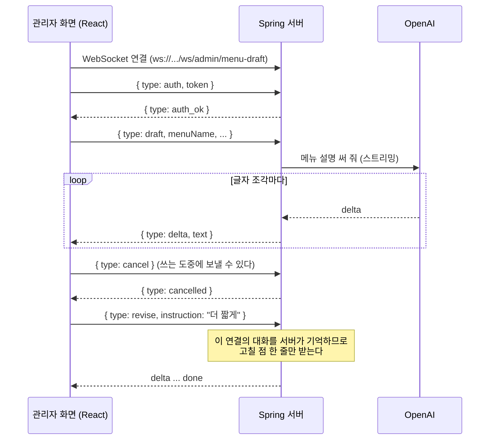

# Phase 3-2 — WebSocket 으로 관리자 메뉴 설명 초안 붙이기

Phase 3-1 에 WebSocket 을 더해, 관리자가 메뉴를 등록 · 수정할 때 AI 가 메뉴 설명을 실시간으로 써 주는 기능을 붙인 완성본이다.
(선택 기능으로 AI 메뉴 사진 만들기도 들어 있다)
Phase 3-1 에서 무엇을 어떻게 바꿨는지는 [`HOWTO-PHASE-3-2.md`](HOWTO-PHASE-3-2.md)에 순서대로 적어 두었다.

```
phase-3-2/
├─ HOWTO-PHASE-3-2.md   Phase 3-1 을 Phase 3-2 로 바꾸는 순서 (이론 + 따라 하기)
├─ REVIEW.md            복습 체크리스트
├─ spring-server/       Phase 3-1 + WebSocket (http://localhost:8080, ws://localhost:8080/ws/admin/menu-draft)
└─ react-client/        Phase 3-1 + 관리자 메뉴 화면의 AI 초안 도우미 (http://localhost:5173)
```

---

## 1. 실행 방법

Phase 3-1 과 같다. (JDK 21, 환경 변수 `OPENAI_API_KEY`, 데이터베이스 · 메뉴 이미지는 Phase 2 와 같다)
처음이라면 `phase-3-1/README.md` 의 1장을 따른다.

IntelliJ 로 `spring-server` 를 열고 `OhgiRestaurantApplication` 을 실행한다. 다른 Phase 의 서버는 먼저 끈다. (같은 8080 포트)

```bash
cd react-client
npm install
npm run dev
```

`http://localhost:5173` 에서 `admin / admin1234` 로 로그인한 뒤 **메뉴 관리 > 메뉴 등록** 으로 간다.
메뉴명 · 카테고리 · 가격 · 재료를 넣고, 상세설명 아래의 **[AI 초안 쓰기]** 를 누른다.

- 글자가 설명 칸에 실시간으로 채워진다. 쓰는 도중 **[중단]** 을 누를 수 있다.
- 다 쓰면 **고칠 점**(예: `더 짧게`)을 적고 **[다시 쓰기]** 를 누른다.
- [선택] **[AI 사진 만들기]** 를 누르면 10초쯤 뒤 메뉴 이미지 자리에 사진이 들어간다. **[등록하기]** 를 눌러야 저장된다.

---

## 2. Phase 3-1 과 달라진 것

| 구분 | Phase 3-1 | Phase 3-2 |
| --- | --- | --- |
| 의존성 | - | `spring-boot-starter-websocket` |
| 새 주소 | - | `ws://localhost:8080/ws/admin/menu-draft` (관리자 전용, 첫 메시지로 인증) |
| 서버 | - | `ai/websocket` (`WebSocketConfig`, `MenuDraftWebSocketHandler`), `MenuDraftService`, [선택] `MenuImageService` |
| 설정 | - | `openai.model.draft`, [선택] `openai.model.image`, `openai.image.*` |
| 화면 | - | 관리자 메뉴 등록 · 수정 화면의 **AI 초안 도우미** (`MenuDraftAssistant`) |

HTTP API 는 Phase 3-1 과 같다.

---

## 3. SSE 대신 WebSocket 을 쓴 이유



- **도중에 끼어들기** : 초안이 만들어지는 도중에 관리자가 [중단]을 보낼 수 있다. SSE 는 서버 -> 브라우저 한 방향이라 응답 중에 브라우저가 무언가를 보낼 수 없다.
- **연결 하나로 계속 주고받기** : 초안 -> 다시 쓰기 -> 다시 쓰기 ... 를 같은 연결로 한다. 서버가 연결마다 대화를 기억하므로 매번 대화 전체를 보낼 필요가 없다.
- 반대로 손님 추천 채팅(3-1)은 질문 하나에 답 하나로 끝나는 구조라, 평범한 HTTP 위에서 동작하는 SSE 가 더 단순하다.
